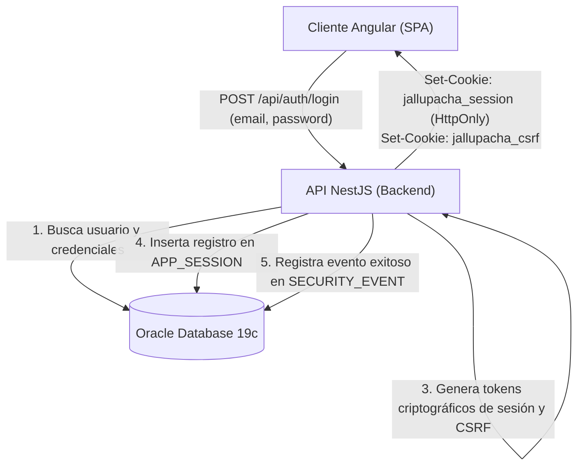
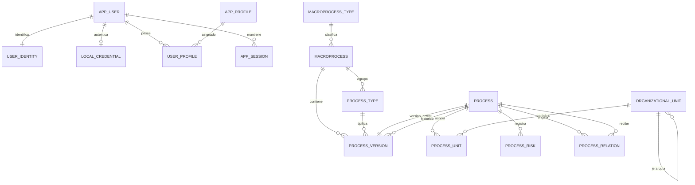

# Arquitectura técnica del Sistema de Procesos Institucionales — Versión 15 (v15)

## 1. Alcance, estado y plataforma oficial

Este documento formaliza la arquitectura técnica de la versión 15 (v15), reemplazando las decisiones del piloto C-011 consignadas en `docs/arquitectura_mvp_v14.md`.

* **Entorno de ejecución:** Despliegue *on-premise* en la red interna (intranet) institucional.
* **Plataforma backend:** Node.js, NestJS, TypeScript, TypeORM.
* **Base de datos oficial:** **Oracle Database 19c** (instalación directa, sin Docker, `synchronize: false`).
* **Plataforma frontend:** Angular (Single Page Application, Standalone Components, Vitest, CSS nativo con tokens de diseño).
* **Seguridad de referencia:** OWASP ASVS v4 Nivel 2 (PT-06).

---

## 2. Modelo de autenticación y sesiones para Intranet (REQ-25 v15, PT-09)

Al operar en una red interna privada sin salida a Internet, la autenticación externa por Google Workspace queda descartada y se reemplaza por **Autenticación Local Institucional con Argon2id**, preparada para su futura interconexión con directorios corporativos.



### 2.1. Tabla de credenciales locales (`LOCAL_CREDENTIAL`)

```sql
CREATE TABLE "LOCAL_CREDENTIAL" (
  USER_ID NUMBER PRIMARY KEY REFERENCES "APP_USER"(ID),
  PASSWORD_HASH VARCHAR2(255 CHAR) NOT NULL,
  FAILED_ATTEMPTS NUMBER(2) DEFAULT 0 NOT NULL,
  LOCKED_UNTIL TIMESTAMP WITH TIME ZONE,
  PASSWORD_UPDATED_AT TIMESTAMP WITH TIME ZONE DEFAULT (SYSTIMESTAMP AT TIME ZONE 'UTC') NOT NULL
);
```

### 2.2. Parámetros criptográficos y mitigación de ataques (PT-06, PT-08)
* **Algoritmo de derivación:** **Argon2id** (RFC 9106), computado en el servidor de aplicaciones Node.js.
* **Protección contra fuerza bruta:** Contador `FAILED_ATTEMPTS`. Al acumular 5 intentos fallidos consecutivos, la cuenta se bloquea automáticamente por 15 minutos (`LOCKED_UNTIL = SYSTIMESTAMP + INTERVAL '15' MINUTE`).
* **Protección contra enumeración:** Todo error de autenticación responde el mensaje neutral: *"Credenciales no válidas"*.
* **Trazabilidad:** Cada intento (exitoso o rechazado) se registra en `SECURITY_EVENT` y `SECURITY_EVENT_IP`.

### 2.3. Gestión de sesión y CSRF (PT-09)
* **Identificador de sesión:** Token pseudoaleatorio criptográfico de 64 caracteres hexadecimales (256 bits de entropía).
* **Almacenamiento en BD:** Se persiste su resumen SHA-256 en la tabla `APP_SESSION`.
* **Expiración por inactividad:** 30 minutos desde la última petición (`LAST_ACTIVITY`).
* **Protección CSRF:** Cada sesión genera un token `jallupacha_csrf`. Toda petición mutante (`POST`, `PUT`, `PATCH`, `DELETE`) debe remitir la cabecera `X-CSRF-Token` coincidente.

### 2.4. Extensibilidad futura a directorio central (LDAP / Active Directory)
La tabla `USER_IDENTITY` mantiene la columna `PROVIDER VARCHAR2(20 CHAR)`. En esta fase su valor es `'LOCAL'`. Cuando la institución autorice la interconexión con LDAP o SAML, se habilitará el conector respectivo asociando el nuevo proveedor sin alterar las sesiones, perfiles ni los datos de procesos.

---

## 3. Modelo de datos institucional en Oracle 19c



### Resumen de tablas del sistema:
1. `APP_USER`: Cuenta base del sistema (`ID`, `IS_DEMO`, `IS_ACTIVE`).
2. `USER_IDENTITY`: Datos de identidad (`DISPLAY_NAME`, `EMAIL`, `PROVIDER`).
3. `LOCAL_CREDENTIAL`: Credenciales seguras para intranet (`PASSWORD_HASH`, `FAILED_ATTEMPTS`, `LOCKED_UNTIL`).
4. `APP_PROFILE`: Catálogo de los 5 perfiles del sistema (`ADMIN`, `PROCESS_OWNER`, `VALIDATOR`, `RISK_MANAGER`, `CONSULTATION`).
5. `USER_PROFILE`: Asignación N:M de perfiles a usuarios.
6. `APP_SESSION`: Sesiones activas con hash de token, hash CSRF y expiración.
7. `AUDIT`: Bitácora inmutable de eventos de negocio y modificaciones (`BEFORE_VALUE`, `AFTER_VALUE`).
8. `SECURITY_EVENT`: Registro de eventos de autenticación y accesos denegados.
9. `MACROPROCESS_TYPE`: Catálogo de tipos de macroproceso (Estratégicos, Misionales, De apoyo).
10. `MACROPROCESS`: Macroprocesos institucionales.
11. `PROCESS_TYPE`: Tipos de proceso administrables asociados a un macroproceso (REQ-51).
12. `ORGANIZATIONAL_UNIT`: Estructura jerárquica de unidades organizacionales (REQ-54).
13. `PROCESS`: Registro maestro del proceso con código inmutable `PRn`.
14. `PROCESS_VERSION`: Ficha completa del proceso con los 26 campos, control de versión y revisión optimista.
15. `PROCESS_UNIT`: Relación con unidad responsable obligatoria y unidades participantes con función (REQ-55).
16. `PROCESS_RISK`: Riesgos asociados al proceso con descripción, causa, consecuencia, tipo y nivel (REQ-15/16).
17. `PROCESS_RELATION`: Relaciones dirigidas entre procesos (`FLUJO`, `DEPENDENCIA`, `COORDINACION`).

---

## 4. Contratos de API REST institucional

Todas las rutas operan bajo el prefijo `/api/`, validan sesión y consultan perfiles en el servidor en cada solicitud (`PT-07`):

### 4.1. Autenticación y Sesión
* `POST /api/auth/login`: Autentica credenciales locales y establece cookies de sesión y CSRF.
* `POST /api/auth/logout`: Revoca la sesión en base de datos y destruye cookies.
* `GET /api/auth/me`: Retorna la identidad del usuario conectado y sus perfiles vigentes.

### 4.2. Mapa y Procesos
* `GET /api/process-map`: Mapa jerárquico completo (Macroprocesos $\rightarrow$ Tipos $\rightarrow$ Procesos).
* `GET /api/macroprocess-types`: Catálogo de macroprocesos por tipo.
* `GET /api/processes`: Búsqueda y listado paginado con filtros.
* `POST /api/processes`: Creación de borrador de proceso (`ADMIN` o `PROCESS_OWNER`).
* `GET /api/processes/:id`: Consulta íntegra de la ficha de 26 campos, unidades, riesgos y relaciones.
* `PATCH /api/processes/:id`: Modificación de borrador con revisión optimista.
* `POST /api/processes/:id/submit`: Envío de borrador a revisión tras verificar completitud mínima y posibles duplicados (REQ-05).
* `POST /api/processes/:id/approve`: Aprobación y publicación de versión vigente por Revisor/Validador (REQ-07).
* `POST /api/processes/:id/reject`: Rechazo de revisión con motivo obligatorio (REQ-07).

### 4.3. Riesgos y Relaciones
* `GET/POST /api/processes/:id/risks`: Consulta y registro de riesgos (`RISK_MANAGER`).
* `PATCH/DELETE /api/processes/:id/risks/:riskId`: Actualización y retiro de riesgo.
* `POST/DELETE /api/processes/:id/relations`: Gestión de dependencias y flujos entre procesos.

### 4.4. Estructura y Catálogos (`ADMIN`)
* `GET/POST/PATCH /api/process-types`: Administración de tipos de proceso (REQ-51).
* `POST/PATCH /api/process-types/:id/deactivate`: Desactivación con validación de procesos activos.
* `GET/POST/PATCH /api/units`: Administración de unidades jerárquicas (REQ-54).
* `POST/PATCH /api/units/:id/deactivate`: Desactivación de unidad.

---

## 5. Arquitectura del Frontend y Principios UX

* **SPA en Angular 19+:** Arquitectura basada en componentes *Standalone* y *Signals*.
* **Consistencia visual y espacial:** Aplica estrictamente `docs/design-system.md` y `docs/marco_estandar_ux_institucional.md`.
* **Diseño limpio y neutral:** Sin cabeceras falsas, sin logos estáticos repetidos ni selectores de perfil invasivos (conforme a la purga aprobada C-019).
* **Guarda de cambios no guardados:** Toda pantalla de captura implementa `LeavesWithConfirmation` y `unsavedChangesGuard` (R-07.2).
* **Acceso y navegación:** La pantalla `/login` presenta el formulario institucional limpio. Una vez autenticado, el usuario accede al mapa institucional `/mapa` y a las funciones habilitadas para sus perfiles.
