# Estándar Institucional de Experiencia de Usuario (UX) y Diseño de Interfaces

**Código Documental:** STD-UX-001  
**Versión:** 1.6 — Guía de principios, reglas, patrones y verificación UX mediante SDD

**Fecha:** 2026-10-22

**Estado en el proyecto:** referencia para diseñar y revisar los próximos cambios de interfaz, conforme a la consolidación documental autorizada por el responsable. No certifica el cumplimiento de la implementación existente.

**Estado institucional:** propuesta pendiente de adopción por la instancia competente de la organización. Su incorporación al repositorio no equivale a adopción institucional ni a autorización de producción.

**Ámbito de Aplicación:** Sistemas web institucionales on-premise accesibles desde la intranet (nuevos desarrollos, sistemas legados migrados y herramientas operativas)  
**Producto de Referencia:** Sistema de Gestión de Procesos (*Jallupacha*)  

---

## 1. Alcance y Ámbito Institucional

### 1.1. Propósito
Este estándar define las directrices y patrones de interfaz de usuario (UI) y experiencia de usuario (UX) para el ecosistema de aplicaciones web de la institución. Su propósito es asegurar coherencia funcional, facilidad de uso, accesibilidad y predictibilidad operativa en los sistemas institucionales, optimizando la interacción y la curva de aprendizaje de los miembros de la comunidad institucional según los perfiles y objetivos de cada sistema.

### 1.2. Ámbito Técnico y Operativo
1. **Infraestructura de Alojamiento:** Aplicaciones alojadas en infraestructura institucional local (*on-premise*).
2. **Canal de Conectividad y Red:** Sistemas concebidos para operar en la red interna (*intranet*) de la institución o mediante mecanismos seguros de acceso corporativo. El estándar no abarca sitios web públicos de difusión general, portales de admisión abierta ni servicios orientados a audiencias externas fuera del entorno institucional.
3. **Público Destinatario:** Las personas que utilizan los sistemas de la organización, conforme a sus tareas y perfiles: operación, consulta, supervisión y administración, entre otros. Los ejemplos deben ser organizacionalmente neutros.
4. **Alcance de Dispositivo Inicial:** Estaciones de trabajo de escritorio. El diseño debe facilitar una futura adaptación a dispositivos móviles evitando patrones rígidos que la obstaculicen (como anchos fijos absolutos sin contenedor elástico), sin exigir la implementación de compatibilidad móvil en la etapa inicial del desarrollo.
5. **Producto de Referencia:** El proyecto *Jallupacha* constituye el primer piloto consumidor y banco de pruebas de este estándar. Sus soluciones particulares ilustran la aplicación práctica de estas normas, pero no sustituyen los principios institucionales generales.

### 1.3. Cómo leer y aplicar esta guía

La guía separa cuatro niveles para evitar que una decisión particular se convierta accidentalmente en una obligación para toda la organización:

| Nivel | Qué establece | Ejemplo |
|---|---|---|
| **Principio (`PUX-*`)** | El resultado que debe proteger el diseño y la razón para hacerlo. Se concreta mediante reglas; no sustituye sus verificaciones. | La persona puede anticipar el resultado de un enlace. |
| **Regla (`R-*`)** | Una obligación verificable cuando corresponde a la tarea. | La etiqueta y el contexto describen correctamente el destino. |
| **Patrón o componente** | Una solución reusable, su contrato y los contextos en los que se ha evaluado. | Migas de pan para una jerarquía real. |
| **Decisión de aplicación** | La solución elegida para un producto, documentada en su arquitectura o especificación. | Navegación horizontal no fija en Jallupacha. |

- **Debe / No debe:** obligación para los cambios del proyecto a los que resulte aplicable. En otros sistemas su exigibilidad depende de la adopción institucional o de la adopción expresa del proyecto correspondiente.
- **Debería:** recomendación; una alternativa debe explicar la necesidad que la justifica.
- **Puede / Ejemplo:** opción o ilustración. No obliga a incorporar una función ni a copiar una pantalla.
- Un comportamiento descrito aquí es un criterio esperado. Su existencia en un documento o en un componente no demuestra que la aplicación lo cumpla.
- Los identificadores R-01 a R-08 se conservan para mantener la trazabilidad histórica. Las precisiones y reglas nuevas se revisan como cambios de diseño, sin modificar código en esta revisión documental.

### 1.4. Autoridad y fuentes del proyecto

1. La fuente de requisitos del producto es [la planilla v15](../referencias/Requisitos_Sistema_Procesos_v15.xlsx). La guía no la modifica ni autoriza nuevos permisos, campos, operaciones o reglas de negocio.
2. [La especificación v15](../producto/especificacion_v15.md) define el comportamiento del producto y [la arquitectura v15](../producto/arquitectura_v15.md) sus decisiones técnicas y de aplicación.
3. Esta guía define principios y reglas de experiencia; [el sistema de diseño](design-system.md) define identidad, tokens y acabado visual; [el catálogo](catalogo-componentes.md) describe las API existentes del kit. Tener un componente disponible no obliga a usarlo en todas las tareas.
4. [AGENTS.md](../../AGENTS.md) define el procedimiento de trabajo y los principios técnicos. Ante un conflicto con un requisito o control de seguridad, registrar el desacuerdo y resolverlo en su fuente antes de implementar. Una excepción UX no puede debilitar esos controles.
5. Los documentos v14 y anteriores son antecedentes históricos retirados del árbol de trabajo mediante C-040; los versionados se recuperan desde Git. Una captura antigua, una corrección registrada o una sugerencia de IA no sustituye la especificación vigente ni acredita conformidad actual.

### 1.5. Principios de UX explícitos

| ID | Principio | Aplicación y reglas relacionadas |
|---|---|---|
| **PUX-01** | **Orientación y consistencia.** La persona reconoce dónde está, qué puede hacer y cómo continuar. | Ubicaciones y términos estables; jerarquías reales. R-01, R-02, R-03. |
| **PUX-02** | **Predicción y claridad.** Las etiquetas, iconos y contexto permiten anticipar el destino o resultado. | Evitar opciones aparentemente diferentes que realizan lo mismo y promesas que el destino no cumple. R-03, R-09. |
| **PUX-03** | **Reconocimiento y simplicidad.** Las opciones relevantes son reconocibles y no exigen recordar rutas ni comparar controles redundantes. | Alternativas justificadas por tareas; evitar duplicación sin beneficio. R-01, R-10. |
| **PUX-04** | **Control y continuidad de la tarea.** La persona puede volver, cancelar y recuperarse sin perder trabajo involuntariamente. | Datos conservados, descarte informado y retorno con contexto. R-04, R-05, R-07, R-11. |
| **PUX-05** | **Fidelidad de la información.** La interfaz diferencia información registrada, ausencia, error y ejemplo; explicita el alcance de sus indicadores. | No presentar contactos ficticios, resultados parciales o valores desconocidos como hechos del registro. R-05, R-06, R-12. |
| **PUX-06** | **Accesibilidad e inclusión.** Las tareas pueden comprenderse y operarse mediante las formas de interacción previstas, incluidas tecnologías de asistencia. | Teclado, foco, estructura semántica, mensajes, contraste, ampliación y reajuste. R-01 a R-12 según el control afectado, especialmente R-08. |
| **PUX-07** | **Adecuación a la tarea y al dominio.** La organización de la interfaz responde a las necesidades de las personas y a la complejidad del trabajo. | Elegir patrones por su propósito; documentar decisiones locales sin imponer una cantidad de menús, pasos o columnas universal. Secciones 3 y 4. |
| **PUX-08** | **Evidencia y reutilización responsable.** Un diseño se comparte con sus condiciones de uso, resultados y límites comprobados. | Evaluar recorridos completos; distinguir existencia, validación y adopción de un patrón. Secciones 5 y 6; PT-01 y PT-03. |

---

## 2. Reglas verificables de experiencia de usuario

Las siguientes reglas se aplican conforme al estado y la autoridad indicados en las secciones 1.3 y 1.4. La sección 6 define cómo registrar su verificación. No todas las reglas implican agregar un control a todas las pantallas.

### R-01: Consistencia Espacial de Navegación y Acciones
1. **Navegación Primaria Estable:** Cuando exista navegación general, debe ocupar una ubicación constante y predecible en las pantallas que comparten ese mecanismo, con el mismo orden relativo de destinos equivalentes. La navegación común no debe duplicarse al cambiar el contenido de una pantalla. Debe adaptarse al espacio disponible sin perder etiquetas, destinos ni funcionamiento. La sección activa debe identificarse visual y semánticamente, distinguiendo la página exacta (`aria-current="page"`) de su sección padre (`aria-current="location"`) cuando corresponda. La orientación horizontal o vertical, el mecanismo de adaptación y la fijación durante el desplazamiento son decisiones de aplicación; en Jallupacha rige la arquitectura v15. Un flujo secuencial que no requiera navegación general debe justificar ese patrón y ofrecer salida y retorno apropiados, sin alterar por esta guía la navegación ya definida del producto.
2. **Separación entre Navegación y Acciones:** La barra de navegación se reserva exclusivamente para alternar entre destinos o módulos funcionales. Todo control operativo que inicie un flujo, modifique datos o afecte a un registro (tales como «Nuevo [Entidad]», «Guardar», «Editar», filtros o exportaciones) debe situarse contiguo al contenido afectado (en la cabecera del panel, formulario o tabla), quedando estrictamente prohibido mezclar botones de acción en la lista de navegación de la aplicación.
3. **Etiquetas Comprensibles y Completas:** Las opciones de navegación deben emplear términos institucionales completos y unívocos, evitando abreviaciones o truncamientos ambiguos que trasladen incertidumbre al usuario (por ejemplo: «Unidades internas» y «Tipos de proceso»).
4. **Ubicación Consistente de Acciones Equivalentes:** Las acciones de la misma naturaleza deben situarse en la misma zona relativa en vistas análogas (por ejemplo: si las acciones de creación y exportación de un catálogo se ubican en la cabecera superior derecha del panel, esa misma convención rige para todos los catálogos de la aplicación).
5. **Rol del Pie de Pantalla o Contenedor:** La zona inferior de las pantallas o paneles puede albergar paginación, contadores de elementos, metadatos, notas de estado, así como acciones o enlaces contextuales directamente vinculados con el contenido de la vista actual (por ejemplo: controles de paginación de una tabla o enlaces de derivación natural del flujo). **Queda prohibido utilizar el pie como menú o barra de navegación principal de la aplicación o para saltar arbitrariamente entre módulos independientes.**
6. **Desacoplamiento de Dimensiones Particulares:** La cantidad de destinos visibles, el orden y la disposición (plana o agrupada) responden a los perfiles, tareas y densidad funcional de cada aplicación; no constituyen una fórmula cuantitativa universal para todo el ecosistema institucional.

### R-02: Migas de Pan en Jerarquías Reales
1. Se debe incluir un mecanismo de migas de pan en toda pantalla subordinada **únicamente cuando exista una jerarquía de navegación real** (por ejemplo: `Módulo raíz > Entidad padre > Detalle del registro`).
2. El primer eslabón debe ofrecer siempre el retorno a la vista principal o raíz del módulo.
3. No se deben incorporar migas de pan ficticias, redundantes o en vistas planas de un solo nivel donde no exista subordinación jerárquica.

### R-03: Convención de Nombres y Acciones Equivalentes
Para evitar discrepancias terminológicas entre sistemas, las acciones comunes deben emplear estrictamente la siguiente nomenclatura estándar, preservando el significado preciso de cada operación:

| Acción Estándar | Propósito Funcional | Nivel Visual Recomendado |
|---|---|---|
| **Nuevo / Nueva [Entidad]** | Iniciar la creación de un nuevo registro, con concordancia gramatical. | Nivel primario |
| **Guardar** / **Guardar [Entidad]** | Persistir los cambios introducidos en un formulario o entidad. | Nivel primario |
| **Cancelar** | Abandonar la edición actual. En una pantalla completa retorna al destino definido por el recorrido; en un editor inline cierra ese editor y conserva el resto de la pantalla; en un diálogo cierra ese diálogo. Si hay cambios pendientes aplica R-07.2. | Nivel secundario o texto |
| **Buscar** | Ejecutar una consulta mediante filtros. | Nivel primario o acción de envío (*submit*) |
| **Limpiar** / **Restablecer** | Restaurar los filtros de búsqueda a su estado inicial. | Nivel secundario |
| **Editar** | Abrir el modo de edición de un registro existente. | Nivel secundario o acción contextual por fila |
| **Desactivar** | Cambiar el estado de un registro a inactivo, inhabilitándolo para operaciones nuevas pero **preservando su historial y trazabilidad** (sin borrado físico). | Nivel secundario o de aviso |
| **Eliminar** | **Supresión o borrado definitivo** de un registro o relación del sistema. Operación destructiva que requiere confirmación previa (R-07). | Nivel de peligro |

Los niveles visuales son recomendaciones según la tarea, no una obligación de destacar todas las acciones por igual. Una acción de negocio específica conserva su nombre aprobado y explica su efecto; esta tabla no autoriza crear operaciones. En enlaces y controles equivalentes la identificación debe ser consistente, sin exigir textos idénticos cuando el contexto justifique una diferencia comprensible (R-09).

### R-04: Conservación de Datos ante Errores
Si el envío de un formulario falla por error de validación o rechazo del servidor:
1. **Los datos de negocio ingresados no deben borrarse, reiniciarse ni sustituirse por valores antiguos como consecuencia del fallo.** El sistema debe conservarlos y señalar los errores específicos para su corrección.
2. Las credenciales y otros campos sensibles siguen la política de seguridad de la aplicación, que puede exigir limpiarlos. La excepción debe estar documentada y no se extiende a los datos de negocio. En el acceso de Jallupacha se conserva el correo y se limpia la contraseña tras un rechazo, conforme al comportamiento documentado en C-024; esta guía no autoriza persistir contraseñas o tokens para recuperar formularios.
3. Una carga fallida de un registro existente no debe presentar un formulario vacío como si fuera una creación o una edición cargada correctamente. Debe informar el fallo y ofrecer continuidad o reintento; no debe permitir guardar una representación incompleta de una ficha que no se pudo cargar.

### R-05: Retroalimentación y Estados de Interfaz
Toda aplicación debe gestionar explícitamente los siguientes estados operativos:
1. **Estado de Carga:** Indicar de forma visual y accesible (`role="status"`) que una operación o consulta está en proceso, evitando pantallas en blanco o bloqueos silenciosos.
2. **Ausencia de Datos (Empty State):** Indicar claramente que la consulta se completó y no hay registros disponibles (por ejemplo, «No hay registros»). Distinguirlo de una búsqueda sin coincidencias, de una carga en curso y de un fallo de consulta.
3. **Búsqueda sin Coincidencias:** Indicar claramente que no hubo resultados para el criterio consultado y ofrecer un mecanismo directo para restablecer los filtros.
4. **Campos Obligatorios:** Señalizar inequívocamente los campos mandatorios desde el inicio de la captura (mediante etiqueta textual *(obligatorio)* o convención aprobada).
5. **Operación en Curso:** Comunicar carga y guardado de manera accesible. Impedir envíos duplicados y definir qué interacciones se permiten mientras la respuesta está pendiente; no anunciar éxito antes de la confirmación del servidor. No desproteger cambios pendientes por el solo hecho de haber iniciado un guardado.
6. **Vigencia de Resultados:** Una respuesta tardía no debe sustituir los resultados de una búsqueda posterior. Si se conserva contenido previo durante una consulta o un fallo, debe identificarse su estado para no presentarlo como resultado de los filtros nuevos.

### R-06: Manejo Diferenciado de Mensajes
1. **Errores de Validación de Campo:** Deben presentarse contiguos al campo afectado, vinculados semánticamente mediante atributos accesibles (`aria-describedby`) y marcando el control con `aria-invalid="true"`.
2. **Fallos Bloqueantes o del Sistema:** Mensajes persistentes (`role="alert"`), redactados en lenguaje institucional sin exponer detalles técnicos internos (trazas de error, consultas SQL o códigos de infraestructura), ofreciendo siempre una vía explícita de continuidad o reintento.
3. **Advertencias de Negocio:** Mensajes de aviso disponibles en el contexto de trabajo hasta que la condición se subsane, sin bloquear innecesariamente el trabajo en borrador cuando la regla de negocio lo permita.
4. **Confirmaciones de Éxito:** Mensajes de confirmación visibles y proporcionados al contexto. No se impone una duración arbitraria fija; si la confirmación es temporal, debe ser legible antes de disiparse.
5. **No forzar desplazamientos automáticos bruscos:** Se debe evitar el desplazamiento automático forzado (*auto-scroll*) que desoriente a usuarios con tecnologías asistivas o ampliadores de pantalla. Se debe priorizar el anuncio accesible mediante regiones en vivo (`aria-live`).

### R-07: Acciones Destructivas y Cambios Pendientes
1. **Confirmación de Acciones Destructivas:** Toda operación irreversible (eliminación definitiva o desvinculación crítica) debe requerir confirmación explícita mediante un diálogo modal accesible antes de su ejecución.
2. **Protección de Cambios No Guardados:** Cuando un formulario —sea una pantalla completa de captura o un subformulario embebido/inline dentro de un panel (como riesgos, relaciones o catálogos inline)— contenga modificaciones pendientes respecto a su estado inicial (`isDirty`), el sistema debe advertir al usuario mediante un diálogo modal accesible antes de abandonar la pantalla, descartar o cerrar la vista, previniendo la pérdida involuntaria de información. Si no existen modificaciones pendientes (`!isDirty`), la navegación o cancelación debe proceder de forma inmediata sin mostrar ningún diálogo.
3. **Cambios dentro de la Misma Pantalla:** La protección incluye seleccionar otro registro para editar, pulsar «Nuevo» sobre un editor abierto, cancelar observaciones o guardar otro subformulario cuando estas acciones reemplazan o cierran una edición pendiente. Una guarda de ruta por sí sola no acredita esta regla. Confirmar el descarte de un editor no autoriza descartar otros formularios.
4. **Respuesta Pendiente y Salida:** Mientras se guarda, se debe impedir la salida que pierda trabajo o conservar de forma segura la edición y definir qué ocurrirá al finalizar la solicitud. Si se permite seguir editando, el éxito de una petición anterior no debe marcar como guardadas modificaciones posteriores. La protección al cerrar o recargar el navegador debe evaluarse según las capacidades de la plataforma y documentarse; no se promete recuperación automática ni almacenamiento persistente de borradores por esta regla.

### R-08: Accesibilidad y Adaptabilidad Visual en Escritorio
1. **Objetivo Propuesto:** Se establece como objetivo técnico la conformidad con las Pautas de Accesibilidad para el Contenido Web (**WCAG 2.2 Nivel AA**).
   > [!NOTE]
   > La conformidad con WCAG 2.2 AA constituye un objetivo propuesto para el ecosistema institucional, pendiente de adopción formal por las instancias de gobernanza correspondientes.
2. **Comprobación Integral y Evaluación Humana:** La verificación de accesibilidad no puede declararse cumplida basándose únicamente en herramientas automatizadas. Requiere comprobaciones automáticas (como validación de contraste y análisis estático) combinadas con **evaluación humana** sobre los criterios aplicables:
   - Navegación exclusiva por teclado y visibilidad y orden lógico del foco.
   - Coherencia en la secuencia de lectura e interpretación con tecnologías de asistencia.
   - Disponibilidad y pertinencia de alternativas textuales en contenido no textual.
   - Comprensión de avisos, estados y mensajes de error.
   *No debe declararse una conformidad que no haya sido efectivamente verificada.*
3. **Ampliación de Texto (*Resize Text* - WCAG 2.2 Criterio 1.4.4):**  
   Excepto para subtítulos e imágenes de texto, el texto de la interfaz debe poder ampliarse hasta un **200%** mediante las funciones estándar del navegador sin requerir tecnologías de asistencia y sin que se pierda contenido ni funcionalidad.
4. **Reajuste de Contenido (*Reflow* - WCAG 2.2 Criterio 1.4.10):**  
   El contenido debe presentarse sin pérdida de información ni funcionalidad, y sin requerir desplazamiento en dos dimensiones (horizontal y vertical de forma simultánea), para:
   - Contenido con desplazamiento vertical a un ancho equivalente a **320 píxeles CSS** (típicamente evaluado en escritorio redimensionando la ventana a 1280 píxeles con un zoom del 400%).
   - Contenido con desplazamiento horizontal a una altura equivalente a **256 píxeles CSS**.
   - **Excepciones Aplicables:** La excepción corresponde a aquellas partes del contenido o de la interfaz cuya disposición bidimensional sea esencial para su uso o significado. En estos casos se admite desplazamiento bidimensional o barras de desplazamiento horizontal (`overflow-x: auto`), como ocurre por ejemplo en:
     - Tablas de datos complejas o multidimensionales donde la relación celda-encabezado requiere preservar la alineación en cuadrícula.
     - Mapas de procesos, esquemas de flujo y diagramas visuales donde la disposición espacial relativa entre elementos perdería su significado al reordenarse en una sola columna.
     - Interfaces gráficas interactivas, lienzos de dibujo o control con barras de herramientas continuas.

### R-09: Destinos predecibles e identificación consistente

1. La etiqueta, el icono y el contexto de un enlace o control deben permitir anticipar su destino o resultado. Un elemento con apariencia interactiva debe ser operable; la información estática no debe simular un control.
2. Los controles recurrentes que realizan la misma función deben identificarse de forma consistente. No se deben presentar nombres o símbolos que sugieran funciones distintas cuando son equivalentes. Se permiten diferencias contextuales claras, como «Volver a resultados» y el nombre del catálogo, sin imponer igualdad literal de etiquetas.
3. Si dos destinos o acciones son distintos, sus nombres y contexto deben permitir reconocer la diferencia. El destino debe entregar el contenido, filtro o función que promete el enlace; no debe obligar a repetir innecesariamente una elección ya realizada.
4. Los cambios de contexto relevantes, como salir de la aplicación o abrir una ventana nueva cuando sea necesario, deben ser previsibles y estar identificados en el punto de acceso. No se debe cambiar de pantalla o enviar un formulario inesperadamente por el solo hecho de recibir foco.

### R-10: Accesos alternativos y redundancia justificada

1. Cada destino o función debe tener una identidad canónica: el mismo registro o tarea se reconoce como tal independientemente del punto de entrada. En aplicaciones web se documenta su ruta de referencia; esto no obliga a una única URL técnica ni a un único camino de acceso.
2. Se pueden ofrecer vías alternativas cuando sirven a tareas o estrategias de búsqueda diferentes, por ejemplo, explorar una estructura y buscar por texto. Deben conducir a la misma ficha o explicar claramente la diferencia de vista, permisos o alcance.
3. La repetición de un enlace o acción dentro de una pantalla debe aportar un beneficio contextual concreto, como evitar un desplazamiento extenso en un formulario. Debe documentarse su finalidad, mantener comportamiento equivalente y revisarse para que no compita innecesariamente con otros controles. La mera posibilidad de que el usuario no vea un enlace no basta como justificación.
4. No se deben reproducir menús generales en paneles o pies como atajos arbitrarios. R-01.5 regula el pie; un enlace contextual relacionado con la tarea no es, por sí mismo, un menú paralelo. Un enlace convencional de identidad a inicio y un destino de inicio se evalúan por su función reconocible; compartir destino no los convierte automáticamente en defecto.
5. La revisión debe inventariar los accesos equivalentes y comprobar su propósito, identificación y resultado. No se eliminan buscadores, enlaces de relación o rutas útiles solo para imponer un camino único. Las alternativas de localización se evalúan según WCAG 2.2, incluidas sus excepciones para pasos de un proceso.

### R-11: Retorno y conservación del contexto

1. Al abrir un registro desde una colección y volver a ella durante el mismo recorrido, se deben conservar los criterios aplicados, la página, el orden y la posición de lectura que existan en ese flujo. Si los datos cambiaron y la posición ya no es válida, informar el reajuste y mantener los criterios que sigan siendo aplicables.
2. La jerarquía de las migas de pan representa la estructura de información, no una copia del historial de clics. El retorno a los resultados de origen puede ofrecerse de forma contextual; no se inventa una jerarquía diferente para cada punto de entrada.
3. Una entrada directa a una ficha debe proporcionar orientación y una salida válida aunque no exista una búsqueda anterior. El destino alternativo de retorno se define en la aplicación; no debe fabricarse un historial.
4. La restauración del contexto no debe conservar credenciales, exponer información de otra sesión ni eludir permisos actuales. No obliga a guardar datos de formulario en almacenamiento persistente. La especificación debe definir los límites del recorrido y qué contexto puede incluirse de forma segura en la dirección o en el estado de navegación.

### R-12: Información fiel e indicadores con alcance explícito

1. Los datos del registro deben provenir de fuentes definidas. No se deben mostrar contactos, responsabilidades, fechas o cifras de ejemplo como si fueran hechos de una entidad. Si el dato no existe, omitirlo o indicar su ausencia; un texto general de ayuda debe distinguirse de un atributo del registro.
   Cuando la aplicación disponga una descripción debajo del nombre de una entidad, ese espacio presenta el contenido registrado que explica su propósito o alcance. Las instrucciones de navegación y las aclaraciones sobre filtros, contadores o límites se sitúan junto al control o indicador correspondiente; no sustituyen esa descripción. La aplicación define qué entidades requieren descripción y verifica su coherencia con los datos asociados (Jallupacha: macroprocesos, C-042).
2. La ausencia de información, un valor cero, un dato no aplicable y un fallo de consulta son estados distintos. No se sustituyen entre sí para completar visualmente una tarjeta o un indicador.
3. Todo resumen o indicador debe explicar qué representa, sobre qué conjunto se calcula y si está afectado por filtros, límites de resultados o datos incompletos. Un subtotal no se presenta como total general. El significado y cálculo de un indicador de negocio deben proceder de la especificación del producto; esta guía no inventa agregaciones.
4. Conceptos distintos deben conservar nombres y representaciones distinguibles. En el piloto, «criticidad del proceso», «nivel de riesgo» y «distribución de riesgos» no son sinónimos; su relación no se deduce de la forma gráfica de un medidor.
5. Las claves técnicas se traducen a términos comprensibles cuando se presentan como contenido de uso habitual. Los estados y niveles mantienen texto o alternativas accesibles; el color no es su único identificador. Los medidores y gráficos deben utilizar semántica accesible compatible con el dato que representan.

---

## 3. Patrones de Referencia de Interfaz (Arquetipos)

El estándar define cuatro arquetipos de interfaz flexibles que describen propósitos comunes y comportamientos recomendados, sin imponer configuraciones particulares obligatorias:

```mermaid
flowchart TD
    subgraph ARQ1 ["Arquetipo 1: Lienzo Visual / Cuadro de Mando"]
        A1["Cabecera y Herramientas Superiores<br/>(Identificación, búsqueda y filtros)"]
        A2["Cuerpo: Espacio de Trabajo Visual / Diagrama<br/>(Flujos, mapas, tableros de control)"]
        A3["Pie de Soporte y Contexto<br/>(Métricas, paginación o enlaces contextuales)"]
        A1 --> A2 --> A3
    end

    subgraph ARQ2 ["Arquetipo 2: Registro Tabular / Catálogo"]
        B1["Cabecera del Panel<br/>(Identificación y acciones contextuales)"]
        B2["Barra de Filtros y Búsqueda"]
        B3["Tabla o Árbol Accesible con Acciones por Registro"]
        B1 --> B2 --> B3
    end

    subgraph ARQ3 ["Arquetipo 3: Ficha de Detalle 360°"]
        C1["Barra Contextual Superior<br/>(Migas de pan si hay jerarquía, acciones principales)"]
        C2["Identificación y Resumen de Entidad<br/>(Nombre, código, estado e indicadores clave)"]
        C3["Bloques de Información y Secciones Operativas"]
        C1 --> C2 --> C3
    end

    subgraph ARQ4 ["Arquetipo 4: Formulario Estructurado"]
        D1["Cabecera con Orientación y Acciones de Cierre"]
        D2["Agrupación Lógica según Complejidad<br/>(Flujo seccionado, pestañas o pasos)"]
        D3["Validación In-Situ y Conservación de Datos"]
        D1 --> D2 --> D3
    end
```



### 3.1. Arquetipo 1: Lienzo Visual o Cuadro de Mando (*Visual Canvas / Dashboard*)
* **Propósito:** Ofrecer una visión sistémica, procedimental o directiva de un conjunto de elementos interrelacionados en una sola vista.
* **Comportamiento Estándar:**
  - Cabecera con identificación clara del espacio de trabajo.
  - Controles de filtrado y herramientas de visualización organizados en la zona superior del panel.
  - El lienzo central representa visualmente los elementos y sus relaciones. Los elementos operables proporcionan acceso directo a sus vistas subordinadas.
  - El pie aloja información de soporte (como contadores de elementos o estados) y puede incluir enlaces o acciones contextuales directamente vinculados con el flujo, sin constituir un menú general de navegación de la aplicación.
  - *Elementos opcionales según el dominio:* Paneles de contexto/resultados, selectores segmentados de agrupación o leyendas explicativas.

### 3.2. Arquetipo 2: Registro Tabular o Catálogo (*Data Registry*)
* **Propósito:** Consulta, filtrado y gestión eficiente de colecciones de datos (expedientes, usuarios, asignaturas, inventarios).
* **Comportamiento Estándar:**
  - Cabecera de panel con identificación clara del catálogo, migas de pan (cuando exista jerarquía real) y acciones principales o de derivación contextual (`panelActions`).
  - Filtros y herramientas de búsqueda dispuestos en la parte superior de la tabla.
  - Tabla de datos accesible con estructura semántica clara (`caption`, `th scope="col"`) y acciones contextuales contiguas a cada registro.
  - Pie con contadores y paginación cuando corresponda al volumen y contrato de consulta. La guía no crea exportaciones, ordenaciones ni filtros nuevos sin requisito de producto.

### 3.3. Arquetipo 3: Ficha de Detalle 360° (*Entity Profile*)
* **Propósito:** Consulta exhaustiva, gobernanza y gestión técnica de una entidad o registro específico.
* **Comportamiento Estándar:**
  - Cabecera contextual superior con migas de pan (cuando exista jerarquía real) y bloque de acciones de gobernanza/ciclo de vida estrictamente diferenciado.
  - Bloque de identificación que destaca el nombre, código y estado de vigencia del registro.
  - Agrupación de datos en bloques temáticos estructurados mediante listas de descripción accesibles u opciones visuales afines (R-12).
  - Secciones operativas subordinadas para la gestión de datos dependientes (relaciones, eventos, documentos asociados).
  - *Elementos opcionales según el dominio:* Tarjetas de gobernanza, medidores visuales de criticidad, bloques de resumen o indicadores de completitud.

### 3.4. Arquetipo 4: Formulario Estructurado (*Data Entry*)
* **Propósito:** Captura y edición controlada de datos institucionales.
* **Comportamiento Estándar:**
  - **Organización según la Tarea:** La estructura del formulario responde a la complejidad y secuencia lógica de los datos:
    - *Flujo lineal seccionado:* Apropiado para formularios directos con agrupaciones temáticas y encabezados claros.
    - *Pestañas temáticas (Tabs):* Recomendado cuando los bloques de datos son independientes y el usuario requiere consultarlos o editarlos en orden flexible.
    - *Asistente por pasos (Stepper):* Recomendado para trámites o flujos con estricta dependencia secuencial entre fases.
  - Los controles de guardado y cancelación deben permanecer fácilmente identificables y accesibles.

---

## 4. Implementación de Referencia: El Piloto Jallupacha

Esta sección identifica decisiones del producto y puntos de evaluación del piloto. No declara que la implementación cumpla todas las reglas, ni convierte sus disposiciones en obligaciones para otros sistemas.

### 4.1. Contexto del Piloto y Trazabilidad de Decisiones
1. **Piloto de Operador Único (`C-011`, Antecedente Histórico v14):**
   La especificación v15 exige autenticación institucional, perfiles y ciclo de vida. El cumplimiento técnico de esos requisitos se verifica por separado; esta guía UX no lo acredita.
2. **Evolución de la Estructura de Navegación del Módulo (arquitectura v15 vigente):**
   Durante el piloto mono-operador v14 se retiró la estructura de shell fija para mantener la fidelidad del lienzo visual. Al reactivarse el modelo multiusuario en v15, se adopta una **navegación local de módulo horizontal, plana y no fija** (`ui-module-nav`), ubicada sobre el contenido, que provee acceso directo a las áreas autorizadas (*Mapa*, *Procesos*, y para `ADMIN`: *Unidades internas*, *Tipos de proceso*, *Usuarios*, *Auditoría*), manteniendo el área de lienzo despejada y sin competir con las cabeceras de la intranet anfitriona.
3. **Neutralidad de Datos (`AGENTS.md`):**  
   Los datos de prueba del sistema emplean terminología institucional neutra («la institución», «la entidad», «la organización»), sin incorporar nombres, marcas, escudos o denominaciones de entidades específicas.
4. **Visualizaciones Piloto y Transición a Estándar Institucional:**  
   El medidor de nivel de riesgo de la ficha y la distribución de riesgo del macroproceso son soluciones exploratorias. Su presencia en el frontend no valida el cálculo ni los convierte en patrones institucionales aprobados. Se deben revisar significado, agregación, conjunto de datos y accesibilidad conforme a R-12 antes de promoverlos; esta revisión documental no autoriza una fórmula ni modifica contratos del producto.

### 4.2. Ejemplos de Implementación de los Arquetipos en Jallupacha

| Arquetipo Institucional | Implementación Particular en Jallupacha | Componente de Referencia |
|---|---|---|
| **Lienzo Visual (Arquetipo 1)** | **Mapa de Procesos Institucional (`/mapa`):** Organizado en tres familias fijas (*Estratégicos*, *Misionales*, *De apoyo*) con flujo horizontal SIPOC (Contexto $\rightarrow$ Familias $\rightarrow$ Resultados), buscador reactivo superior y pie con métricas de visualización. | `ProcessMapComponent` |
| **Registro Tabular (Arquetipo 2)** | **Catálogos (`/procesos`, `/unidades`, `/tipos-de-proceso`):** Paneles con identificación, acciones contextuales y tablas. La jerarquía de las migas se evalúa con R-02; no se prescribe el mapa como padre de todos los catálogos ni se reintroducen accesos cruzados retirados en C-029. | `ProcessListComponent`, `UnitsComponent`, `ProcessTypesComponent` |
| **Ficha 360° (Arquetipo 3)** | **Ficha de Proceso (`/procesos/:id`):** Identificación, propósito, gobernanza, campos y editores de riesgos y relaciones. El medidor representa nivel de riesgo, no el campo criticidad; su validez se evalúa por separado. La grilla de tres tarjetas es una elección local. | `ProcessDetailComponent` |
| **Formulario Estructurado (Arquetipo 4)** | **Captura de Procesos (`/procesos/nuevo`, `:id/editar`):** Formulario con secciones temáticas (`ui-section`) para clasificación, identificación, unidades internas con vinculación dinámica de participantes y campos técnicos extendidos. | `ProcessFormComponent` |

### 4.3. Destinos y recorridos de referencia del piloto

| Tarea | Destino de referencia existente | Criterio de evaluación |
|---|---|---|
| Explorar la estructura | `/mapa` y `/mapa/macroprocesos/:id` | Son etapas relacionadas del mismo recorrido, no dos alternativas independientes a contar como duplicación. |
| Buscar procesos | `/procesos` | Sirve una estrategia de localización diferente de la exploración del mapa. |
| Consultar un proceso | `/procesos/:id` | El registro mantiene su identidad al llegar desde búsqueda, macroproceso o una relación. |
| Crear o editar un borrador | `/procesos/nuevo` y `/procesos/:id/editar` | Acciones junto al contenido afectado; permisos y reglas de negocio siguen en sus fuentes. |
| Administrar unidades, tipos, usuarios o auditoría | `/unidades`, `/tipos-de-proceso`, `/usuarios`, `/auditoria` | Acceso por navegación autorizada; no son automáticamente descendientes del mapa. |

La arquitectura v15 conserva la sección «Procesos» activa en las fichas y formularios. La jerarquía conceptual de las migas y el retorno contextual de cada recorrido deben explicitarse y comprobarse al corregir esas pantallas; la tabla no certifica que se hayan corregido. No se exige sincronizar todos los filtros entre mapa y listado: se conserva el contexto de cada recorrido y se evita prometer filtros que el destino no aplica.

La barra horizontal no fija, el subrayado de ubicación y el número actual de destinos son decisiones documentadas para este producto. No constituyen un patrón obligatorio de distribución de pantallas para toda la organización. El inventario de accesos y la evaluación de R-10 incluyen también enlaces contextuales; el objetivo no es eliminar todos los enlaces que comparten destino.

---

## 5. Gestión de Versiones, Mantenimiento y Excepciones

### 5.1. Control de Versiones y Mantenimiento del Estándar
Cualquier modificación a este estándar debe quedar registrada con su versión, fecha, motivación y resumen de cambios. Al evaluar actualizaciones o extensiones del documento, se debe analizar su impacto sobre los sistemas en operación y facilitar su adopción progresiva.

| Versión | Fecha | Motivación | Resumen de Cambios |
|---|---|---|---|
| **1.0** | 2026-10-21 | Formalización inicial del estándar | Desacoplamiento de las normas generales respecto a particularidades de Jallupacha. Establecimiento de 8 reglas obligatorias y 4 arquetipos de referencia. |
| **1.1** | 2026-10-21 | Revisión colegiada de alcance y accesibilidad | Ampliación del alcance a toda la comunidad institucional; flexibilización del rol del pie (acciones contextuales); distinción semántica entre Desactivar y Eliminar; incorporación explícita de WCAG 2.2 1.4.4 (Ampliación) y 1.4.10 (Reajuste). |
| **1.2** | 2026-10-21 | Consolidación normativa y desacoplamiento técnico | Sustitución de nombres de componentes (`ui-breadcrumbs`) y clases CSS por conceptos normativos y niveles visuales recomendados (R-02, R-03). Flexibilización de excepciones de reajuste en R-08.4 mediante criterio esencial no taxativo. |
| **1.3** | 2026-10-21 | Armonización documental y correcciones UX | Incorporación explícita del rol de las visualizaciones piloto (4.1.4); alineación de confirmaciones modales accesibles (R-07.1), protección de cambios no guardados (R-07.2), niveles visuales de desactivación y edición (R-03) y validación de campo in-situ (R-06.1). |
| **1.4** | 2026-10-22 | Navegación local institucional y superación de shell v14 | Estandarización de navegación primaria estable (R-01.1): barra plana no fija, separación entre navegación y acciones, etiquetas completas, correspondencia activa en subrutas y reajuste elástico sin desborde. |
| **1.5** | 2026-10-22 | Corrección del indicador activo (C-030) | Distinción semántica de página y sección padre; referencia al subrayado recto compartido del sistema de diseño. |
| **1.6** | 2026-10-22 | Consolidación de la guía UX mediante SDD (C-031) | Principios explícitos; separación de niveles y autoridad; reglas R-09 a R-12; precisión de cancelación, datos sensibles y ediciones pendientes; criterios de aceptación, evidencia, gobierno y adopción. Cambio exclusivamente documental. |

### 5.2. Tratamiento de Excepciones

Revisión documental C-040 (2026-10-22) de la versión 1.6: limpieza de referencias históricas retiradas y remisión a fuentes vigentes; sin cambios de principios, reglas, alcance ni criterios de adopción.

1. Cuando un sistema institucional posea un requerimiento operativo singular que justifique apartarse de alguna de las reglas de este estándar (por ejemplo: un visor analítico especializado o una herramienta de dibujo de diagramas que requiera lienzos libres con barras flotantes), dicha desviación debe quedar documentada en la especificación técnica del proyecto.
2. El registro de excepción debe señalar:
   - La regla estándar afectada.
   - La justificación operativa o de dominio que la motiva.
   - Las medidas implementadas para resguardar la consistencia de uso y los principios de accesibilidad.
   - La aplicación, versión y tarea a las que se limita; las alternativas evaluadas; la evidencia, responsable de aceptación y condición o fecha de revisión.
3. La excepción se registra en la documentación del producto y en el mismo cambio de Git. No cambia la regla para otros sistemas ni autoriza excepciones a requisitos, permisos, seguridad o protección de datos.
4. Los comportamientos que aún incumplen una regla se registran como fallidos o no probados según la evidencia. Su existencia previa no equivale a una excepción aprobada.

### 5.3. Responsabilidades y adopción de patrones

Las siguientes son funciones de gobierno que la organización debe asignar; esta guía no designa personas ni crea una autoridad institucional:

| Función | Responsabilidad |
|---|---|
| Responsable del producto | Define tareas y alcance; resuelve decisiones de producto y acepta excepciones dentro de su autoridad. |
| Mantenimiento de la guía y del sistema de diseño | Mantiene versiones, contratos y relaciones entre reglas, patrones y componentes; documenta compatibilidad y migración. |
| Revisión de diseño y verificación | Examina recorridos y evidencia, incluidas accesibilidad y alternativas de acceso; distingue observación de hipótesis. Una revisión IA no sustituye evaluación humana o conformidad requerida. |
| Instancia de adopción institucional | Decide la adopción organizacional, las responsabilidades y el calendario para otros sistemas. Permanece por definir hasta una decisión formal. |

Un patrón se registra con uno de estos estados, indicando siempre contexto y evidencia:

- **Propuesto:** existe una idea o especificación; no hay validación suficiente.
- **Piloto en evaluación:** existe una implementación con pruebas delimitadas y pendientes explícitos.
- **Validado en un contexto:** hay evidencia de uso con personas representativas, incluidas necesidades de accesibilidad, y comprobaciones técnicas pertinentes. No se extrapola automáticamente a otras tareas o aplicaciones.
- **Adoptado institucionalmente:** la instancia competente acepta alcance, soporte y condiciones de uso; se registra versión y decisión.
- **En retirada:** se identifica reemplazo, compatibilidad, motivo y transición para consumidores existentes.

Antes de promover una solución del piloto se debe comprobar que atiende una necesidad compartida, reutiliza lo existente o justifica reemplazarlo, funciona con contenido y estados representativos, y documenta límites, accesibilidad y soporte. La existencia de capturas, código o pruebas unitarias no basta para promoverla. La documentación debe explicar cuándo usarla, cuándo evitarla, sus estados, contrato y verificaciones conocidas.

Los cambios compartidos deben identificar consumidores afectados y ofrecer instrucciones de migración o compatibilidad. Una nueva versión de la guía no demuestra una migración automática del frontend ni obliga a modificar otros sistemas sin una decisión de adopción.

### 5.4. Trazabilidad con la documentación del repositorio

- [Especificación vigente v15](../producto/especificacion_v15.md) y [arquitectura vigente v15](../producto/arquitectura_v15.md).
- [Fundamentos del sistema de diseño](design-system.md) y [catálogo de componentes](catalogo-componentes.md).
- [Reglas de trabajo](../../AGENTS.md) y [registro de correcciones](../trazabilidad/correcciones.md).
- [Tokens](../../frontend/src/app/shared/ui/styles/tokens.css) y [estilos base](../../frontend/src/app/shared/ui/styles/base.css).
- Antecedentes del piloto: retirados mediante C-040 y recuperables desde Git si estaban versionados. No gobiernan la navegación multiusuario vigente.

## 6. Aplicación mediante SDD y evidencia de revisión

### 6.1. Procedimiento por cambio

1. Identificar tarea, personas o perfiles afectados, punto de entrada y resultado esperado. Leer requisito, arquitectura, principio y regla aplicables; no buscar únicamente coincidencias con el nombre de un componente.
2. Clasificar el hallazgo conforme a AGENTS.md: defecto de implementación, defecto de especificación/diseño o cambio de producto. Si cambia el diseño, corregir y revisar primero su documento; si cambia el producto, obtener la aprobación de alcance antes de implementarlo.
3. Describir el comportamiento esperado y una verificación concreta antes de editar comportamiento. Inventariar accesos equivalentes, distinguir contenido común de contenido de ruta y registrar decisiones sobre retorno, descarte y estados pendientes cuando correspondan.
4. Implementar solo el cambio autorizado utilizando los fundamentos y componentes pertinentes. La revisión de esta guía no ejecuta este paso ni crea una nueva arquitectura.
5. Verificar el recorrido significativo más pequeño: entrada, operación, resultado, retorno, cancelación y fallos afectados. Incluir accesos alternativos y teclado; ampliar por impacto o fallo. Persistencia, transacciones, SQL o grants requieren evidencia Oracle conforme a las reglas del proyecto.
6. Registrar resultado y revisión en el mismo cambio de Git, usando los documentos existentes y `docs/trazabilidad/correcciones.md`. No crear un registro paralelo de hallazgos ni convertir conversaciones en especificaciones.

### 6.2. Criterios mínimos de aceptación por regla

La tabla es un índice de comprobación. Cada fila agrupa las subreglas aplicables y no las sustituye. Para un cambio pequeño se seleccionan las reglas afectadas; una revisión integral de navegación debe incluir al menos R-01, R-02 y R-09 a R-11, además de R-07 cuando haya edición y R-08.

| Regla | Comprobación observable | Evidencia pertinente |
|---|---|---|
| **R-01** | Destinos comunes conservan posición y orden; la ubicación activa coincide con la pantalla; acciones están junto a su contenido y no hay menús paralelos arbitrarios. | Inventario de destinos por perfil, recorrido entre rutas y revisión de cabecera/contenido/pie por separado. |
| **R-02** | Cada eslabón representa un antecesor real; no se inventan padres al entrar por otro camino; se puede volver al antecesor indicado. | Jerarquía documentada, entrada directa y recorrido de enlaces. |
| **R-03** | El nombre de cada acción corresponde a su efecto; Cancelar afecta solo al ámbito de edición definido y respeta R-07. | Textos visibles y recorrido de formulario completo, inline o diálogo afectado. |
| **R-04** | Un fallo de validación o servidor conserva los datos de negocio; una carga fallida no habilita guardar una ficha vacía; campos sensibles siguen su política. | Fallo controlado y comparación de los valores antes/después. |
| **R-05** | Carga, vacío, ausencia de coincidencias, error y operación pendiente son distinguibles; no hay doble envío ni sustitución por respuestas antiguas. | Respuesta pendiente, respuestas en distinto orden y resultados vacíos en el recorrido afectado. |
| **R-06** | Errores de campo tienen asociación accesible; fallos bloqueantes ofrecen continuidad; mensajes y gestión de foco no desorientan. | Inspección semántica, teclado, lectura de mensajes y evaluación asistiva cuando corresponda. |
| **R-07** | Sin cambios se sale inmediatamente; con cambios se confirma una sola vez; cancelar el descarte conserva datos; cambiar de editor o guardar otro no pierde trabajo. | Recorrido de edición dentro de ruta y entre rutas, con guardado pendiente y fallo. |
| **R-08** | El contenido y las tareas afectadas mantienen acceso por teclado, foco visible, semántica, contraste, ampliación y reajuste aplicables. | Colores efectivos, revisión visual, ampliación real al 200 %, reajuste y evaluación con tecnologías de asistencia. Registrar alcance y excepciones esenciales. |
| **R-09** | Antes de activar un control se puede anticipar su resultado; después se obtiene lo anunciado; controles equivalentes son reconocibles. | Comparación entre etiqueta/contexto y destino/efecto, incluidas entradas directas. |
| **R-10** | Cada acceso alternativo tiene una tarea o beneficio identificable; las repeticiones no sugieren falsas diferencias ni crean menús paralelos. | Inventario de accesos, justificación y revisión de recorridos equivalentes. |
| **R-11** | Volver desde un registro restaura el contexto válido del origen; entrada directa tiene salida válida; no se arrastra contexto entre sesiones. | Recorrido de ida/vuelta y entrada directa, con filtros y datos cambiados cuando aplique. |
| **R-12** | Se distingue información registrada, ausente y de ayuda; indicadores identifican conjunto, cálculo aprobado y filtros; no hay ejemplos presentados como hechos. | Contraste con contrato y datos de prueba neutrales, verificación de totales/subtotales y alternativas accesibles. |

### 6.3. Estados de verificación y condición de cierre

| Estado | Uso |
|---|---|
| **Aprobado en la comprobación** | Se ejecutó el caso indicado y se cumplió el resultado esperado. Identificar versión, entorno, método y evidencia. No significa aprobación institucional. |
| **Fallido** | Se ejecutó y existe una diferencia observable respecto a la regla; registrar resultado real y corrección pendiente. |
| **No probado** | No se ejecutó la comprobación o falta evidencia suficiente. Una lectura de código, captura o prueba de otro recorrido no acredita el caso. |
| **No aplica** | Explicar por qué la regla o subregla no corresponde a la tarea. La falta de tiempo o de herramienta no es motivo de no aplicabilidad. |

Una comprobación automática no reemplaza una comprobación humana distinta. Un ancho de 320 píxeles CSS no acredita por sí solo ampliación real al 200 %, y una revisión visual no acredita uso con lector de pantalla. El funcionamiento y el texto real se revisan junto con el contraste de los colores efectivos; mantener tokens aprobados no demuestra todas sus combinaciones.

Un cambio no se declara conforme si tiene verificaciones necesarias fallidas o no probadas. Se registran los pendientes y la decisión competente que corresponda; una excepción válida no convierte una comprobación no ejecutada en aprobada. La conformidad y pruebas requeridas antes de producción permanecen bajo PT-03, PT-04 y las demás reglas de seguridad del proyecto.

La aprobación de una propuesta documental y el cumplimiento de la interfaz son resultados diferentes. Este documento puede revisarse y versionarse conservando como no probada la futura implementación de sus criterios.

### 6.4. Registro breve para el mismo cambio de Git

Utilizar este esquema dentro de la anotación correspondiente en `docs/trazabilidad/correcciones.md` o la documentación de revisión del cambio. No se exige un archivo o herramienta nueva por cada regla.

```text
Hallazgo y clasificación SDD:
Fuente y requisito de producto (si aplica):
Tarea, perfil y recorrido afectados:
Principios y reglas aplicables (incluidas subreglas):
Comportamiento esperado y decisión de diseño:
Accesos equivalentes y beneficio de cada uno (si aplica):
Casos: precondición -> pasos -> resultado esperado:
Evidencia: versión/entorno, método, fecha, resultado real y ubicación:
Estado por comprobación: Aprobado en la comprobación / Fallido / No probado / No aplica:
Revisión registrada: autor, alcance, observaciones y límites:
Pendientes o excepción aceptada: responsable, alcance y revisión prevista:
Impacto: requisitos, permisos, datos, consumidores del kit y migración:
```

### 6.5. Ejemplos de revisión de recorridos

Son casos de aceptación ilustrativos con datos genéricos, no resultados ejecutados ni nuevas funciones de producto.

- **Explorar y buscar:** llegar al mismo proceso desde un macroproceso y desde el listado. Comprobar identidad de la ficha y orientación; ambos accesos son útiles si atienden esas tareas. Mapa y detalle de macroproceso son etapas de la exploración, no duplicados independientes de ese recorrido.
- **Duplicación sin beneficio:** encontrar dos botones de creación en la misma vista. Comprobar si evitan un coste real en un recorrido extenso y si son reconocibles como la misma acción. Sin ese beneficio, conservar la ubicación contextual definida, sin crear una prohibición universal de enlaces alternativos.
- **Volver a resultados:** aplicar los filtros existentes y abrir una ficha. Volver con el mecanismo definido y con el historial del navegador; comprobar los criterios, página y posición del recorrido. Entrar directamente a la ficha y comprobar el destino alternativo sin inventar filtros anteriores.
- **Edición inline:** modificar un riesgo y solicitar editar otro. Cancelar el descarte debe conservar el primer texto. Guardar una relación no debe cerrar ese riesgo ni borrar observaciones pendientes de otro editor.
- **Carga y guardado:** interrumpir la carga de una ficha existente y comprobar error con reintento, sin habilitar una ficha vacía. Mantener un guardado pendiente y comprobar aviso, prevención de doble envío y protección de las modificaciones que aún no se han confirmado.
- **Indicador filtrado:** usar un conjunto ficticio y conocido, aplicar un filtro y comparar el resumen con ese conjunto. La etiqueta debe distinguir entre resumen general y resultados filtrados; una consulta limitada no puede presentarse como total completo. La fórmula se toma de la especificación del indicador, no se decide al escribir la prueba.
- **Contenido de registro:** comprobar que cada contacto o función mostrados tienen una fuente definida. Si el contrato no ofrece ese dato, no completar la tarjeta con un correo, anexo o atribución de ejemplo. Probar texto largo, datos ausentes y estados diferentes con teclado y ampliación.

## 7. Referencias externas y límites de su uso

Las referencias sustentan la guía; sus ejemplos, marcas y componentes no se incorporan a la identidad del producto. La redacción de principios y criterios es una adaptación para este proyecto, no una certificación ni transcripción de una norma externa.

- [Heurísticas de usabilidad de Nielsen Norman Group](https://www.nngroup.com/articles/ten-usability-heuristics/): orientación, reconocimiento, control y consistencia.
- [Enlaces duplicados en una misma página](https://www.nngroup.com/articles/duplicate-links/) y [vías alternativas de navegación](https://www.nngroup.com/articles/reduce-redundancydecrease-duplicated-design-decisions/): evaluar la utilidad contextual de la redundancia, sin imponer un camino único.
- [Information scent](https://www.nngroup.com/articles/information-scent/): correspondencia entre las señales del enlace y el contenido esperado. Un defecto que desorienta no acredita por sí mismo manipulación deliberada.
- [WCAG 2.2](https://www.w3.org/TR/WCAG22/): referencia de accesibilidad, incluidos navegación consistente, propósito de enlaces, múltiples vías, identificación consistente, foco, contraste, texto y reajuste. Cada criterio conserva su nivel y sus excepciones; esta guía puede establecer reglas propias adicionales, como la orientación contextual, sin atribuirlas erróneamente a un criterio AA.
- [Criterios de contribución de GOV.UK Design System](https://design-system.service.gov.uk/community/contribution-criteria/): referencia para utilidad, ausencia de duplicación innecesaria, evidencia de uso y versatilidad antes de promover patrones compartidos. No se adoptan su marca ni sus decisiones particulares de navegación.
