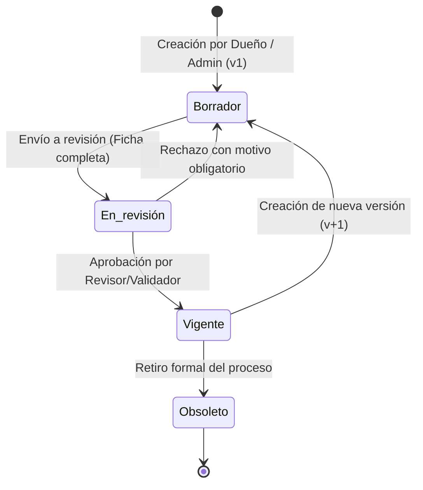

# Especificación funcional del Sistema de Procesos Institucionales — Versión 15 (v15)

## 1. Estado, autoridad y alcance

La especificación de la versión 15 (v15) define el producto institucional para su operación en la red interna (intranet) bajo un modelo multiusuario y control de acceso basado en perfiles. 

Toma como línea base funcional la planilla `docs/referencias/Requisitos_Sistema_Procesos_v15.xlsx` (actualizada desde la versión 14), incorporando formalmente la decisión de arquitectura autorizada por el responsable del producto:
1. **Sustitución de REQ-25 (Autenticación externa Google Workspace por Autenticación Local Institucional):** Debido a que la aplicación opera en un entorno de red privada institucional (intranet) sin salida obligatoria a Internet ni interconexión inmediata a servicios de terceros, la autenticación se realiza de forma autónoma y segura mediante credenciales locales gestionadas por la entidad (correo institucional y contraseña con hashing robusto Argon2id). El diseño queda preparado para conectarse a directorios corporativos internos (como LDAP o Active Directory) cuando la infraestructura de red lo habilite.
2. **Superación del piloto de operador único (C-011):** Se restablece el modelo institucional multiusuario pleno, reactivando los requisitos de identidad, perfiles, auditoría de usuario y ciclo de vida de procesos que habían sido transitoriamente postergados durante el piloto.

Los documentos `docs/mvp_v14.md` y `docs/arquitectura_mvp_v14.md` pasan a ser antecedentes históricos del piloto mono-operador C-011.

---

## 2. Perfiles y roles institucionales (REQ-26)

El sistema define cinco perfiles institucionales fijos. Cada usuario activo tiene asignado al menos un perfil en el sistema:

| Perfil | Código técnico | Alcance y responsabilidades |
| :--- | :--- | :--- |
| **Administrador** | `ADMIN` | Gestión integral de la configuración institucional: administración de tipos de proceso (REQ-51), estructura jerárquica de unidades internas (REQ-54), gestión de usuarios y asignación de perfiles, reasignación de responsables de proceso y supervisión de auditoría. |
| **Dueño de proceso** | `PROCESS_OWNER` | Elaboración y edición de fichas de proceso dentro de su macroproceso (REQ-05). Asocia unidades responsables y participantes (REQ-55), gestiona borradores y envía procesos a revisión. |
| **Revisor / Validador** | `VALIDATOR` | Revisión técnica y aprobación o rechazo de los procesos enviados a revisión por los dueños de proceso (REQ-07). Debe ser una persona distinta de quien elaboró el proceso. |
| **Gestor de riesgos** | `RISK_MANAGER` | Identificación, registro y mantenimiento de los riesgos asociados a los procesos institucionales (REQ-15, REQ-16). |
| **Consulta** | `CONSULTATION` | Acceso de lectura para cualquier integrante de la institución: visualización del mapa de procesos jerárquico, búsqueda avanzada y consulta íntegra de fichas vigentes y sus relaciones (REQ-06, REQ-19). |

---

## 3. Ciclo de vida y estados del proceso (REQ-07, REQ-09, REQ-56)

El sistema gestiona el ciclo de vida del proceso a través de cuatro estados inmutables y versionados:

1. **Borrador:** Estado inicial de trabajo. Permite guardado parcial e incompleto.
2. **En revisión:** Se activa cuando el Dueño de proceso envía la ficha a validación. Para el envío se exige el cumplimiento estricto de los campos mínimos y la presencia de una unidad responsable activa (REQ-05, REQ-55).
3. **Vigente:** Proceso oficial aprobado por el Revisor/Validador. Solo existe una versión vigente activa por código de proceso.
4. **Obsoleto:** Proceso que ha sido formalmente retirado o sustituido por una versión posterior (REQ-09).

---

## 4. Requisitos Imprescindibles del Sistema v15

### REQ-25 (v15) — Autenticación Local Institucional para Intranet
Los usuarios del sistema ingresan mediante sus credenciales institucionales (correo corporativo y contraseña).
* La contraseña se verifica contra la base de datos institucional usando hashing robusto mediante **Argon2id** (OWASP ASVS v4 Nivel 2).
* El sistema bloquea temporalmente la cuenta tras 5 intentos fallidos consecutivos durante un lapso de 15 minutos para mitigar ataques de fuerza bruta.
* La sesión se gestiona de forma segura en el servidor, cerrándose automáticamente tras 30 minutos de inactividad (PT-09).
* La comunicación utiliza cookies protegidas (`HttpOnly`, `SameSite=Strict`) y protección CSRF mediante cabecera `X-CSRF-Token` vinculada a la sesión.
* La arquitectura mantiene el campo `PROVIDER` en la identidad (`'LOCAL'`) para permitir la integración transparente con LDAP o Active Directory corporativo cuando la red institucional lo disponga.

### REQ-26 — Control de acceso por perfiles
Cada petición recibida en el servidor verifica la existencia de sesión activa y la posesión del perfil requerido para la operación solicitada (PT-07). Ocultar botones en la interfaz no constituye control de acceso.

### REQ-27 — Trazabilidad y auditoría
Toda acción administrativa, creación, modificación, reasignación, cambio de estado de proceso y evento de seguridad (inicio de sesión, intento fallido, acceso denegado) se registra en la bitácora de auditoría inmutable, indicando usuario actor, fecha/hora UTC, dirección IP, acción, valores previos y valores posteriores.

### REQ-01, REQ-02, REQ-04 — Estructura jerárquica del mapa institucional
Los procesos se organizan jerárquicamente en:
$$\text{Tipos de Macroproceso} \longrightarrow \text{Macroprocesos} \longrightarrow \text{Tipos de Proceso} \longrightarrow \text{Procesos}$$
* Tipos de Macroproceso iniciales: Estratégicos, Misionales y De apoyo.
* La estructura base de tipos de macroproceso y macroprocesos permanece estable para garantizar la coherencia institucional.

### REQ-51 — Gestión de tipos de proceso
El Administrador crea, edita y desactiva tipos de proceso asociados a un macroproceso específico.
* No se puede desactivar un tipo de proceso que contenga procesos activos; el sistema notifica el número de procesos a reclasificar.

### REQ-54 — Gestión de unidades internas
El Administrador gestiona la estructura jerárquica de las unidades organizacionales de la entidad (Vicerrectorías, Direcciones, Departamentos y unidades dependientes).
* Toda unidad puede tener una unidad superior, salvo las unidades raíz.
* El sistema valida la jerarquía e impide ciclos o autorreferencias.
* Las unidades no se eliminan físicamente; se desactivan. No se permite asociar unidades inactivas a procesos nuevos o en edición.

### REQ-05 — Creación y edición de procesos
El Dueño de proceso o el Administrador crea y edita borradores de procesos dentro de un macroproceso y tipo determinado.
* El usuario que crea el proceso queda registrado como su elaborador; la persona o cargo responsable del proceso se registra de forma independiente.
* El código del proceso (`PRn`) es asignado automáticamente por el servidor mediante secuencia institucional; es único e inmutable.
* El borrador puede guardarse incompleto.
* Para enviar a revisión, el sistema exige: nombre, clasificación completa, descripción, objetivo, alcance con inicio y término, persona o cargo responsable, una unidad responsable activa y al menos una entrada y una salida.
* Antes del envío, el sistema alerta sobre posibles duplicados por nombre o alias dentro de la misma clasificación.

### REQ-06 — Ficha integral del proceso
Cualquier usuario de la entidad puede consultar la ficha completa de un proceso, que contiene los 26 campos reglamentarios:
1. Código (ID del proceso)
2. Nombre
3. Alias
4. Macroproceso
5. Tipo de proceso
6. Proceso padre
7. Tipo de subproceso
8. Subprocesos asociados
9. Unidades internas (responsable y participantes con su función)
10. Área de negocio
11. Elaborador
12. Responsable
13. Involucrados
14. Entradas
15. Salidas
16. Proveedores
17. Clientes
18. Documentos
19. Sistemas utilizados
20. Indicadores
21. Oportunidades de mejora
22. Criticidad
23. Grado de automatización
24. Periodicidad
25. Cuándo inicia / Cuándo termina (Alcance)
26. Plan de desarrollo, operación, diseño, validación, estado y referencia al modelo BPMN.

### REQ-55 — Asociación de unidades al proceso
El proceso tiene exactamente una unidad responsable activa y puede tener múltiples unidades participantes. Para cada participante se detalla su función específica en el proceso.

### REQ-15 y REQ-16 — Gestión de riesgos en el proceso
El Gestor de riesgos registra, actualiza y evalúa riesgos directamente en la ficha del proceso.
* Cada riesgo incluye descripción, causa, consecuencia, tipo de riesgo y nivel de severidad (`Bajo`, `Medio`, `Alto`, `Crítico`).

### REQ-19 — Búsqueda institucional
Cualquier usuario puede buscar procesos mediante texto libre (código, nombre, descripción, responsable, clasificación o unidad). La búsqueda es insensible a mayúsculas y acentos.
