# Estándar Institucional de Experiencia de Usuario (UX) y Diseño de Interfaces

**Código Documental:** STD-UX-001  
**Versión:** 1.2 (Propuesta técnica consolidada para revisión)  
**Estado:** Propuesta técnica para revisión institucional previa a adopción  
**Ámbito de Aplicación:** Sistemas web institucionales on-premise accesibles desde la intranet (nuevos desarrollos, sistemas legados migrados y herramientas operativas)  
**Producto de Referencia:** Sistema de Gestión de Procesos (*Jallupacha*)  

---

## 1. Alcance y Ámbito Institucional

### 1.1. Propósito
Este estándar define las directrices y patrones de interfaz de usuario (UI) y experiencia de usuario (UX) para el ecosistema de aplicaciones web de la institución. Su propósito es asegurar coherencia funcional, facilidad de uso, accesibilidad y predictibilidad operativa en los sistemas institucionales, optimizando la interacción y la curva de aprendizaje de los miembros de la comunidad institucional según los perfiles y objetivos de cada sistema.

### 1.2. Ámbito Técnico y Operativo
1. **Infraestructura de Alojamiento:** Aplicaciones alojadas en infraestructura institucional local (*on-premise*).
2. **Canal de Conectividad y Red:** Sistemas concebidos para operar en la red interna (*intranet*) de la institución o mediante mecanismos seguros de acceso corporativo. El estándar no abarca sitios web públicos de difusión general, portales de admisión abierta ni servicios orientados a audiencias externas fuera del entorno institucional.
3. **Público Destinatario:** Los miembros de la comunidad institucional (estudiantes, personal académico, personal de administración y servicios, directivos y roles operativos específicos) conforme a la finalidad particular de cada aplicación (gestión académica, procesos administrativos, finanzas, apoyo institucional, etc.).
4. **Alcance de Dispositivo Inicial:** Estaciones de trabajo de escritorio. El diseño debe facilitar una futura adaptación a dispositivos móviles evitando patrones rígidos que la obstaculicen (como anchos fijos absolutos sin contenedor elástico), sin exigir la implementación de compatibilidad móvil en la etapa inicial del desarrollo.
5. **Producto de Referencia:** El proyecto *Jallupacha* constituye el primer piloto consumidor y banco de pruebas de este estándar. Sus soluciones particulares ilustran la aplicación práctica de estas normas, pero no sustituyen los principios institucionales generales.

### 1.3. Criterios de Interpretación Normativa
A lo largo de este documento se distinguen tres niveles normativos:
- **Obligaciones (Debe / No debe):** Reglas mínimas esenciales de cumplimiento y verificación obligatoria en todo desarrollo.
- **Recomendaciones (Debería):** Buenas prácticas de diseño que deben seguirse salvo que la complejidad o naturaleza del flujo justifique documentar una alternativa.
- **Ejemplos de Referencia:** Ilustraciones concretas basadas en el piloto *Jallupacha*, que no limitan otras aplicaciones del estándar.

---

## 2. Reglas Obligatorias Institucionales

Las siguientes reglas son de observancia general para todas las aplicaciones web institucionales dentro del alcance:

### R-01: Consistencia Espacial de Navegación y Acciones
1. **Navegación Primaria Estable:** La navegación general o de primer nivel de la aplicación debe ocupar una ubicación espacial constante y predecible a lo largo de todas las pantallas del sistema.
2. **Acciones Contextuales Próximas al Contenido:** Todo control que afecte a un elemento específico (acciones por fila de tabla, botones de tarjeta, controles de sección) debe situarse en proximidad directa con el contenido afectado.
3. **Ubicación Consistente de Acciones Equivalentes:** Las acciones de la misma naturaleza deben situarse en la misma zona relativa en vistas análogas (por ejemplo: si las acciones de creación y exportación de un catálogo se ubican en la cabecera superior derecha del panel, esa misma convención rige para todos los catálogos de la aplicación).
4. **Rol del Pie de Pantalla o Contenedor:** La zona inferior de las pantallas o paneles puede albergar paginación, contadores de elementos, metadatos, notas de estado, así como acciones o enlaces contextuales directamente vinculados con el contenido de la vista actual (por ejemplo: controles de paginación de una tabla o enlaces de derivación natural del flujo). **Queda prohibido utilizar el pie como menú o barra de navegación principal de la aplicación o para saltar arbitrariamente entre módulos independientes.**

### R-02: Migas de Pan en Jerarquías Reales
1. Se debe incluir un mecanismo de migas de pan en toda pantalla subordinada **únicamente cuando exista una jerarquía de navegación real** (por ejemplo: `Módulo raíz > Entidad padre > Detalle del registro`).
2. El primer eslabón debe ofrecer siempre el retorno a la vista principal o raíz del módulo.
3. No se deben incorporar migas de pan ficticias, redundantes o en vistas planas de un solo nivel donde no exista subordinación jerárquica.

### R-03: Convención de Nombres y Acciones Equivalentes
Para evitar discrepancias terminológicas entre sistemas, las acciones comunes deben emplear estrictamente la siguiente nomenclatura estándar, preservando el significado preciso de cada operación:

| Acción Estándar | Propósito Funcional | Nivel Visual Recomendado |
|---|---|---|
| **Nuevo [Entidad]** | Iniciar la creación de un nuevo registro. | Nivel primario |
| **Guardar** / **Guardar [Entidad]** | Persistir los cambios introducidos en un formulario o entidad. | Nivel primario |
| **Cancelar** | Descartar cambios no guardados y regresar a la vista anterior. | Nivel secundario o texto |
| **Buscar** | Ejecutar una consulta mediante filtros. | Nivel primario o acción de envío (*submit*) |
| **Limpiar** / **Restablecer** | Restaurar los filtros de búsqueda a su estado inicial. | Nivel secundario |
| **Editar** | Abrir el modo de edición de un registro existente. | Nivel secundario o acción contextual por fila |
| **Desactivar** | Cambiar el estado de un registro a inactivo, inhabilitándolo para operaciones nuevas pero **preservando su historial y trazabilidad** (sin borrado físico). | Nivel secundario o de aviso |
| **Eliminar** | **Supresión o borrado definitivo** de un registro o relación del sistema. Operación destructiva que requiere confirmación previa (R-07). | Nivel de peligro |

### R-04: Conservación de Datos ante Errores
Si el envío de un formulario falla por error de validación o rechazo del servidor:
1. **Los datos ya ingresados por el usuario no deben borrarse ni reiniciarse bajo ninguna circunstancia.**
2. El sistema debe conservar todos los campos con los valores introducidos y señalar con claridad los errores específicos para su corrección.

### R-05: Retroalimentación y Estados de Interfaz
Toda aplicación debe gestionar explícitamente los siguientes estados operativos:
1. **Estado de Carga:** Indicar de forma visual y accesible (`role="status"`) que una operación o consulta está en proceso, evitando pantallas en blanco o bloqueos silenciosos.
2. **Ausencia de Datos (Empty State):** Indicar con claridad cuando una entidad o catálogo no contiene registros, informando si la ausencia es estructural (*"No hay registros registrados"*) o transitoria.
3. **Búsqueda sin Coincidencias:** Indicar claramente que no hubo resultados para el criterio consultado y ofrecer un mecanismo directo para restablecer los filtros.
4. **Campos Obligatorios:** Señalizar inequívocamente los campos mandatorios desde el inicio de la captura (mediante etiqueta textual *(obligatorio)* o convención aprobada).

### R-06: Manejo Diferenciado de Mensajes
1. **Errores de Validación de Campo:** Deben presentarse contiguos al campo afectado, vinculados semánticamente mediante atributos accesibles (`aria-describedby`) y marcando el control con `aria-invalid="true"`.
2. **Fallos Bloqueantes o del Sistema:** Mensajes persistentes (`role="alert"`), redactados en lenguaje institucional sin exponer detalles técnicos internos (trazas de error, consultas SQL o códigos de infraestructura), ofreciendo siempre una vía explícita de continuidad o reintento.
3. **Advertencias de Negocio:** Mensajes de aviso disponibles en el contexto de trabajo hasta que la condición se subsane, sin bloquear innecesariamente el trabajo en borrador cuando la regla de negocio lo permita.
4. **Confirmaciones de Éxito:** Mensajes de confirmación visibles y proporcionados al contexto. No se impone una duración arbitraria fija; si la confirmación es temporal, debe ser legible antes de disiparse.
5. **No forzar desplazamientos automáticos bruscos:** Se debe evitar el desplazamiento automático forzado (*auto-scroll*) que desoriente a usuarios con tecnologías asistivas o ampliadores de pantalla. Se debe priorizar el anuncio accesible mediante regiones en vivo (`aria-live`).

### R-07: Acciones Destructivas y Cambios Pendientes
1. **Confirmación de Acciones Destructivas:** Toda operación irreversible (eliminación definitiva o desvinculación crítica) debe requerir confirmación explícita mediante un diálogo modal accesible antes de su ejecución.
2. **Protección de Cambios No Guardados:** Cuando un formulario —sea una pantalla completa de captura o un subformulario embebido/inline dentro de un panel (como riesgos, relaciones o catálogos inline)— contenga modificaciones pendientes respecto a su estado inicial (`isDirty`), el sistema debe advertir al usuario mediante un diálogo modal accesible antes de abandonar la pantalla, descartar o cerrar la vista, previniendo la pérdida involuntaria de información. Si no existen modificaciones pendientes (`!isDirty`), la navegación o cancelación debe proceder de forma inmediata sin mostrar ningún diálogo.

### R-08: Accesibilidad y Adaptabilidad Visual en Escritorio
1. **Objetivo Propuesto:** Se establece como objetivo técnico la conformidad con las Pautas de Accesibilidad para el Contenido Web (**WCAG 2.2 Nivel AA**).
   > [!NOTE]
   > La conformidad con WCAG 2.2 AA constituye un objetivo propuesto para el ecosistema institucional, pendiente de adopción formal por las instancias de gobernanza correspondientes.
2. **Comprobación Integral y Evaluación Humana:** La verificación de accesibilidad no puede declararse cumplida basándose únicamente en herramientas automatizadas. Requiere comprobaciones automáticas (como validación de contraste y análisis estático) combinadas con **evaluación humana** sobre los criterios aplicables:
   - Navegación exclusiva por teclado y visibilidad y orden lógico del foco.
   - Coherencia en la secuencia de lectura e interpretación con tecnologías de asistencia.
   - Disponibilidad y pertinencia de alternativas textuales en contenido no textual.
   - Comprensión de avisos, estados y mensajes de error.
   *No debe declararse una conformidad que no haya sido efectivamente verificada.*
3. **Ampliación de Texto (*Resize Text* - WCAG 2.2 Criterio 1.4.4):**  
   Excepto para subtítulos e imágenes de texto, el texto de la interfaz debe poder ampliarse hasta un **200%** mediante las funciones estándar del navegador sin requerir tecnologías de asistencia y sin que se pierda contenido ni funcionalidad.
4. **Reajuste de Contenido (*Reflow* - WCAG 2.2 Criterio 1.4.10):**  
   El contenido debe presentarse sin pérdida de información ni funcionalidad, y sin requerir desplazamiento en dos dimensiones (horizontal y vertical de forma simultánea), para:
   - Contenido con desplazamiento vertical a un ancho equivalente a **320 píxeles CSS** (típicamente evaluado en escritorio redimensionando la ventana a 1280 píxeles con un zoom del 400%).
   - Contenido con desplazamiento horizontal a una altura equivalente a **256 píxeles CSS**.
   - **Excepciones Aplicables:** La excepción corresponde a aquellas partes del contenido o de la interfaz cuya disposición bidimensional sea esencial para su uso o significado. En estos casos se admite desplazamiento bidimensional o barras de desplazamiento horizontal (`overflow-x: auto`), como ocurre por ejemplo en:
     - Tablas de datos complejas o multidimensionales donde la relación celda-encabezado requiere preservar la alineación en cuadrícula.
     - Mapas de procesos, esquemas de flujo y diagramas visuales donde la disposición espacial relativa entre elementos perdería su significado al reordenarse en una sola columna.
     - Interfaces gráficas interactivas, lienzos de dibujo o control con barras de herramientas continuas.

---

## 3. Patrones de Referencia de Interfaz (Arquetipos)

El estándar define cuatro arquetipos de interfaz flexibles que describen propósitos comunes y comportamientos recomendados, sin imponer configuraciones particulares obligatorias:

```mermaid
flowchart TD
    subgraph ARQ1 ["Arquetipo 1: Lienzo Visual / Cuadro de Mando"]
        A1["Herramientas de Exploración Superiores<br/>(Búsqueda, filtros generales, ayuda)"]
        A2["Cuerpo: Espacio de Trabajo Visual / Diagrama<br/>(Flujos, mapas, tableros de control)"]
        A3["Pie de Soporte y Contexto<br/>(Métricas, paginación o enlaces contextuales)"]
        A1 --> A2 --> A3
    end

    subgraph ARQ2 ["Arquetipo 2: Registro Tabular / Catálogo"]
        B1["Cabecera del Panel<br/>(Identificación, acciones de catálogo y enlaces cruzados)"]
        B2["Barra de Filtros y Búsqueda"]
        B3["Tabla o Árbol Accesible con Acciones por Registro"]
        B1 --> B2 --> B3
    end

    subgraph ARQ3 ["Arquetipo 3: Ficha de Detalle 360°"]
        C1["Barra Contextual Superior<br/>(Migas de pan si hay jerarquía, acciones principales)"]
        C2["Identificación y Resumen de Entidad<br/>(Nombre, código, estado e indicadores clave)"]
        C3["Bloques de Información y Secciones Operativas"]
        C1 --> C2 --> C3
    end

    subgraph ARQ4 ["Arquetipo 4: Formulario Estructurado"]
        D1["Cabecera con Orientación y Acciones de Cierre"]
        D2["Agrupación Lógica según Complejidad<br/>(Flujo seccionado, pestañas o pasos)"]
        D3["Validación In-Situ y Conservación de Datos"]
        D1 --> D2 --> D3
    end
```

### 3.1. Arquetipo 1: Lienzo Visual o Cuadro de Mando (*Visual Canvas / Dashboard*)
* **Propósito:** Ofrecer una visión sistémica, procedimental o directiva de un conjunto de elementos interrelacionados en una sola vista.
* **Comportamiento Estándar:**
  - Controles de filtrado y herramientas de visualización organizados en la zona superior del panel.
  - El lienzo central representa visualmente los elementos y sus relaciones. Los elementos operables proporcionan acceso directo a sus vistas subordinadas.
  - El pie aloja información de soporte (como contadores de elementos o estados) y puede incluir enlaces o acciones contextuales directamente vinculados con el flujo, sin constituir un menú general de navegación de la aplicación.
  - *Elementos opcionales según el dominio:* Paneles de contexto/resultados, selectores segmentados de agrupación o leyendas explicativas.

### 3.2. Arquetipo 2: Registro Tabular o Catálogo (*Data Registry*)
* **Propósito:** Consulta, filtrado y gestión eficiente de colecciones de datos (expedientes, usuarios, asignaturas, inventarios).
* **Comportamiento Estándar:**
  - Cabecera de panel con identificación clara del catálogo, migas de pan (cuando exista jerarquía real) y acciones principales o de derivación contextual.
  - Filtros y herramientas de búsqueda dispuestos en la parte superior de la tabla.
  - Tabla de datos accesible con estructura semántica clara (`caption`, `th scope="col"`) y acciones contextuales contiguas a cada registro.
  - Pie con control de paginación pasiva y contadores de resultados.

### 3.3. Arquetipo 3: Ficha de Detalle 360° (*Entity Profile*)
* **Propósito:** Consulta exhaustiva, gobernanza y gestión técnica de una entidad o registro específico.
* **Comportamiento Estándar:**
  - Cabecera contextual superior con migas de pan (cuando exista jerarquía real) y acciones maestras de la entidad.
  - Bloque de identificación que destaca el nombre, código y estado de vigencia del registro.
  - Agrupación de datos en bloques temáticos estructurados mediante listas de descripción accesibles u opciones visuales afines.
  - Secciones operativas subordinadas para la gestión de datos dependientes (relaciones, eventos, documentos asociados).
  - *Elementos opcionales según el dominio:* Tarjetas de gobernanza, medidores visuales de criticidad, bloques de resumen o indicadores de completitud.

### 3.4. Arquetipo 4: Formulario Estructurado (*Data Entry*)
* **Propósito:** Captura y edición controlada de datos institucionales.
* **Comportamiento Estándar:**
  - **Organización según la Tarea:** La estructura del formulario responde a la complejidad y secuencia lógica de los datos:
    - *Flujo lineal seccionado:* Apropiado para formularios directos con agrupaciones temáticas y encabezados claros.
    - *Pestañas temáticas (Tabs):* Recomendado cuando los bloques de datos son independientes y el usuario requiere consultarlos o editarlos en orden flexible.
    - *Asistente por pasos (Stepper):* Recomendado para trámites o flujos con estricta dependencia secuencial entre fases.
  - Los controles de guardado y cancelación deben permanecer fácilmente identificables y accesibles.

---

## 4. Implementación de Referencia: El Piloto Jallupacha

En esta sección se documenta cómo el producto de referencia *Jallupacha* implementa el estándar institucional y se registran sus decisiones particulares:

### 4.1. Contexto del Piloto y Trazabilidad de Decisiones
1. **Piloto de Operador Único (`C-011`):**  
   Por decisión formal de producto, el MVP v14 de Jallupacha opera en un entorno controlado para un único operador técnico. No incorpora en esta fase autenticación de usuarios, perfiles conmutables ni flujos de validación/aprobación. Los campos de elaborador y responsable se gestionan como texto institucional en la ficha del proceso.
2. **Retiro de Estructura Shell Global (`adaptacion_visual_mvp_v14.md`):**  
   Para preservar la fidelidad del mapa respecto a la referencia visual aprobada por el responsable, Jallupacha retiró la cabecera institucional fija, el pie global y las barras laterales, renderizando directamente el contenido de cada ruta. La navegación se resuelve mediante paneles contextuales y migas de pan superiores.
3. **Neutralidad de Datos (`AGENTS.md`):**  
   Los datos de prueba del sistema emplean terminología institucional neutra («la institución», «la entidad», «la organización»), sin incorporar nombres, marcas, escudos o denominaciones de entidades específicas.
4. **Visualizaciones Piloto y Transición a Estándar Institucional:**  
   Los componentes de visualización del piloto (como el widget gauge de criticidad en la ficha de proceso y la barra de distribución de riesgo en macroprocesos) formaron parte del ejercicio de exploración de diseño visual del piloto. Se preservan en el frontend como base empírica para la generalización y consolidación del estándar institucional de UI/UX, sin alterar los contratos funcionales del backend.

### 4.2. Ejemplos de Implementación de los Arquetipos en Jallupacha

| Arquetipo Institucional | Implementación Particular en Jallupacha | Componente de Referencia |
|---|---|---|
| **Lienzo Visual (Arquetipo 1)** | **Mapa de Procesos Institucional (`/mapa`):** Organizado en tres familias fijas (*Estratégicos*, *Misionales*, *De apoyo*) con flujo horizontal SIPOC (Contexto $\rightarrow$ Familias $\rightarrow$ Resultados), buscador reactivo superior y pie con métricas de visualización y enlace a *Buscar procesos*. | `MvpV14DemoComponent` |
| **Registro Tabular (Arquetipo 2)** | **Catálogos Institucionales (`/procesos`, `/unidades`, `/tipos-de-proceso`):** Paneles estructurados con `ui-panel`, migas de pan superiores hacia el mapa, acciones cruzadas en `panelActions` y tablas accesibles. | `ProcessListComponent`, `UnitsComponent`, `ProcessTypesComponent` |
| **Ficha 360° (Arquetipo 3)** | **Ficha Técnica de Proceso (`/procesos/:id`):** Cabecera con tarjeta de identificación, widget *gauge* de 4 ranuras de criticidad (ejemplo específico del piloto), bloque de propósito, grilla tripartita de gobernanza (Unidad Responsable, Responsable del Proceso, Unidades Participantes) y CRUDs embebidos de riesgos y relaciones. | `ProcessDetailComponent` |
| **Formulario Estructurado (Arquetipo 4)** | **Captura de Procesos (`/procesos/nuevo`, `:id/editar`):** Formulario con secciones temáticas (`ui-section`) para clasificación, identificación, unidades internas con vinculación dinámica de participantes y campos técnicos extendidos. | `ProcessFormComponent` |

---

## 5. Gestión de Versiones, Mantenimiento y Excepciones

### 5.1. Control de Versiones y Mantenimiento del Estándar
Cualquier modificación a este estándar debe quedar registrada con su versión, fecha, motivación y resumen de cambios. Al evaluar actualizaciones o extensiones del documento, se debe analizar su impacto sobre los sistemas en operación y facilitar su adopción progresiva.

| Versión | Fecha | Motivación | Resumen de Cambios |
|---|---|---|---|
| **1.0** | 2026-10-21 | Formalización inicial del estándar | Desacoplamiento de las normas generales respecto a particularidades de Jallupacha. Establecimiento de 8 reglas obligatorias y 4 arquetipos de referencia. |
| **1.1** | 2026-10-21 | Revisión colegiada de alcance y accesibilidad | Ampliación del alcance a toda la comunidad institucional; flexibilización del rol del pie (acciones contextuales); distinción semántica entre Desactivar y Eliminar; incorporación explícita de WCAG 2.2 1.4.4 (Ampliación) y 1.4.10 (Reajuste). |
| **1.2** | 2026-10-21 | Consolidación normativa y desacoplamiento técnico | Sustitución de nombres de componentes (`ui-breadcrumbs`) y clases CSS por conceptos normativos y niveles visuales recomendados (R-02, R-03). Flexibilización de excepciones de reajuste en R-08.4 mediante criterio esencial no taxativo. |
| **1.3** | 2026-10-21 | Armonización documental y correcciones UX | Incorporación explícita del rol de las visualizaciones piloto (4.1.4); alineación de confirmaciones modales accesibles (R-07.1), protección de cambios no guardados (R-07.2), niveles visuales de desactivación y edición (R-03) y validación de campo in-situ (R-06.1). |

### 5.2. Tratamiento de Excepciones
1. Cuando un sistema institucional posea un requerimiento operativo singular que justifique apartarse de alguna de las reglas de este estándar (por ejemplo: un visor analítico especializado o una herramienta de dibujo de diagramas que requiera lienzos libres con barras flotantes), dicha desviación debe quedar documentada en la especificación técnica del proyecto.
2. El registro de excepción debe señalar:
   - La regla estándar afectada.
   - La justificación operativa o de dominio que la motiva.
   - Las medidas implementadas para resguardar la consistencia de uso y los principios de accesibilidad.

### 5.3. Trazabilidad con la Documentación del Repositorio
* **Tokens de Estilo:** `frontend/src/app/shared/ui/styles/tokens.css`
* **Estilos Base del Kit:** `frontend/src/app/shared/ui/styles/base.css`
* **Catálogo de Componentes:** `docs/catalogo-componentes.md`
* **Fundamentos del Sistema de Diseño:** `docs/design-system.md`
* **Reglas de Trabajo:** `AGENTS.md`
* **Especificación del Piloto v14:** `docs/mvp_v14.md` y `docs/arquitectura_mvp_v14.md`
