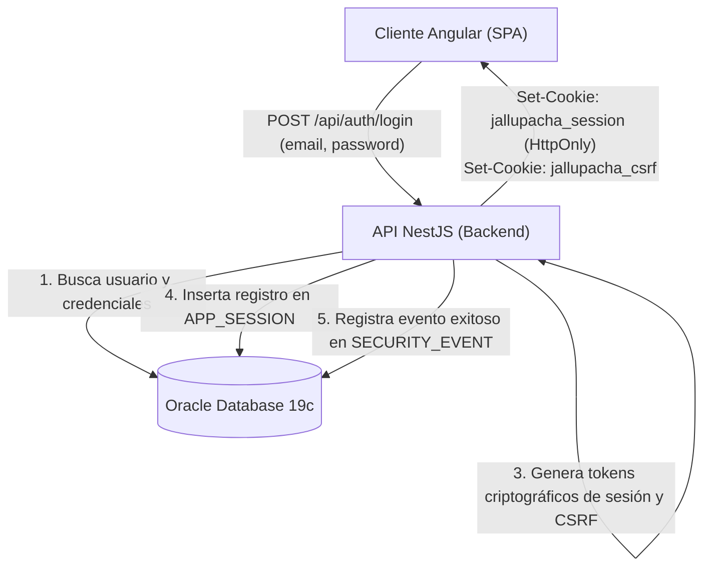
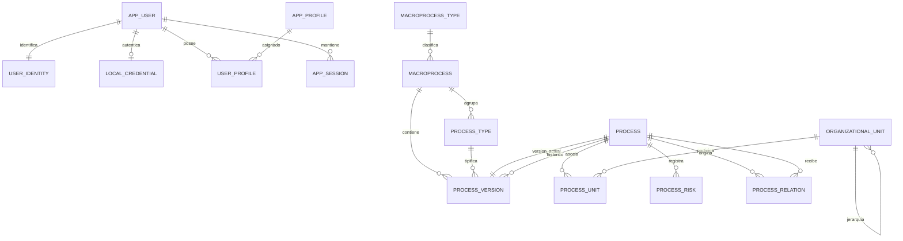

# Arquitectura técnica del Sistema de Procesos Institucionales — Versión 15 (v15)

## 1. Alcance, estado y plataforma oficial

Este documento formaliza la arquitectura técnica de la versión 15 (v15), reemplazando las decisiones del piloto C-011. La documentación histórica se retiró del árbol de trabajo mediante C-040; los antecedentes versionados permanecen en Git.

* **Entorno de ejecución:** Despliegue *on-premise* en la red interna (intranet) institucional.
* **Plataforma backend:** Node.js, NestJS, TypeScript, TypeORM.
* **Base de datos oficial:** **Oracle Database 19c** (instalación directa, sin Docker, `synchronize: false`).
* **Plataforma frontend:** Angular (Single Page Application, Standalone Components, Vitest, CSS nativo con tokens de diseño).
* **Seguridad de referencia:** OWASP ASVS v4 Nivel 2 (PT-06).

---

## 2. Modelo de autenticación y sesiones para Intranet (REQ-25 v15, PT-09)

Al operar en una red interna privada sin salida a Internet, la autenticación externa por Google Workspace queda descartada y se reemplaza por **Autenticación Local Institucional con Argon2id**, preparada para su futura interconexión con directorios corporativos.



### 2.1. Tabla de credenciales locales (`LOCAL_CREDENTIAL`)

```sql
CREATE TABLE "LOCAL_CREDENTIAL" (
  USER_ID NUMBER PRIMARY KEY REFERENCES "APP_USER"(ID),
  PASSWORD_HASH VARCHAR2(255 CHAR) NOT NULL,
  FAILED_ATTEMPTS NUMBER(2) DEFAULT 0 NOT NULL,
  LOCKED_UNTIL TIMESTAMP WITH TIME ZONE,
  PASSWORD_UPDATED_AT TIMESTAMP WITH TIME ZONE DEFAULT (SYSTIMESTAMP AT TIME ZONE 'UTC') NOT NULL
);
```

### 2.2. Parámetros criptográficos y mitigación de ataques (PT-06, PT-08)
* **Algoritmo de derivación:** **Argon2id** (RFC 9106), computado en el servidor de aplicaciones Node.js.
* **Protección contra fuerza bruta:** Contador `FAILED_ATTEMPTS`. Al acumular 5 intentos fallidos consecutivos, la cuenta se bloquea automáticamente por 15 minutos (`LOCKED_UNTIL = SYSTIMESTAMP + INTERVAL '15' MINUTE`).
* **Protección contra enumeración:** Todo error de autenticación responde el mensaje neutral: *"Credenciales no válidas"*.
* **Trazabilidad:** Cada intento (exitoso o rechazado) se registra en `SECURITY_EVENT` y `SECURITY_EVENT_IP`.

### 2.3. Gestión de sesión y CSRF (PT-09)
* **Identificador de sesión:** Token pseudoaleatorio criptográfico de 64 caracteres hexadecimales (256 bits de entropía).
* **Almacenamiento en BD:** Se persiste su resumen SHA-256 en la tabla `APP_SESSION`.
* **Expiración por inactividad:** 30 minutos desde la última petición (`LAST_ACTIVITY`).
* **Protección CSRF:** Cada sesión genera un token `jallupacha_csrf`. Toda petición mutante (`POST`, `PUT`, `PATCH`, `DELETE`) debe remitir la cabecera `X-CSRF-Token` coincidente.

### 2.4. Extensibilidad futura a directorio central (LDAP / Active Directory)
La tabla `USER_IDENTITY` mantiene la columna `PROVIDER VARCHAR2(20 CHAR)`. En esta fase su valor es `'LOCAL'`. Cuando la institución autorice la interconexión con LDAP o SAML, se habilitará el conector respectivo asociando el nuevo proveedor sin alterar las sesiones, perfiles ni los datos de procesos.

---

## 3. Modelo de datos institucional en Oracle 19c



### Resumen de tablas del sistema:
1. `APP_USER`: Cuenta base del sistema (`ID`, `IS_DEMO`, `IS_ACTIVE`).
2. `USER_IDENTITY`: Datos de identidad (`DISPLAY_NAME`, `EMAIL`, `PROVIDER`).
3. `LOCAL_CREDENTIAL`: Credenciales seguras para intranet (`PASSWORD_HASH`, `FAILED_ATTEMPTS`, `LOCKED_UNTIL`).
4. `APP_PROFILE`: Catálogo de los 5 perfiles del sistema (`ADMIN`, `PROCESS_OWNER`, `VALIDATOR`, `RISK_MANAGER`, `CONSULTATION`).
5. `USER_PROFILE`: Asignación N:M de perfiles a usuarios.
6. `APP_SESSION`: Sesiones activas con hash de token, hash CSRF y expiración.
7. `AUDIT`: Bitácora inmutable de eventos de negocio y modificaciones (`BEFORE_VALUE`, `AFTER_VALUE`).
8. `SECURITY_EVENT`: Registro de eventos de autenticación y accesos denegados.
9. `MACROPROCESS_TYPE`: Catálogo de tipos de macroproceso (Estratégicos, Misionales, De apoyo).
10. `MACROPROCESS`: Macroprocesos institucionales.
11. `PROCESS_TYPE`: Tipos de proceso administrables asociados a un macroproceso (REQ-51).
12. `ORGANIZATIONAL_UNIT`: Estructura jerárquica de unidades organizacionales (REQ-54).
13. `PROCESS`: Registro maestro del proceso con código inmutable `PRn`.
14. `PROCESS_VERSION`: Ficha completa del proceso con los 26 campos, control de versión y revisión optimista.
15. `PROCESS_UNIT`: Relación con unidad responsable obligatoria y unidades participantes con función (REQ-55).
16. `PROCESS_RISK`: Riesgos asociados al proceso con descripción, causa, consecuencia, tipo y nivel (REQ-15/16).
17. `PROCESS_RELATION`: Relaciones dirigidas entre procesos (`FLUJO`, `DEPENDENCIA`, `COORDINACION`).

---

## 4. Contratos de API REST institucional

Todas las rutas operan bajo el prefijo `/api/`, validan sesión y consultan perfiles en el servidor en cada solicitud (`PT-07`):

### 4.1. Autenticación y Sesión
* `POST /api/auth/login`: Autentica credenciales locales y establece cookies de sesión y CSRF.
* `POST /api/auth/logout`: Revoca la sesión en base de datos y destruye cookies.
* `GET /api/auth/me`: Retorna la identidad del usuario conectado y sus perfiles vigentes.

### 4.2. Mapa y Procesos
* `GET /api/process-map`: Mapa jerárquico completo (Macroprocesos $\rightarrow$ Tipos $\rightarrow$ Procesos).
* `GET /api/macroprocess-types`: Catálogo de macroprocesos por tipo.
* `GET /api/processes`: Búsqueda y listado paginado con filtros.
* `POST /api/processes`: Creación de borrador de proceso (`ADMIN` o `PROCESS_OWNER`).
* `GET /api/processes/:id`: Consulta íntegra de la ficha de 26 campos, unidades, riesgos y relaciones.
* `PATCH /api/processes/:id`: Modificación de borrador con revisión optimista.
* `POST /api/processes/:id/submit`: Envío de borrador a revisión tras verificar completitud mínima y posibles duplicados (REQ-05).
* `POST /api/processes/:id/approve`: Aprobación y publicación de versión vigente por Revisor/Validador (REQ-07).
* `POST /api/processes/:id/reject`: Rechazo de revisión con motivo obligatorio (REQ-07).

### 4.3. Riesgos y Relaciones
* `GET/POST /api/processes/:id/risks`: Consulta y registro de riesgos (`RISK_MANAGER`).
* `PATCH/DELETE /api/processes/:id/risks/:riskId`: Actualización y retiro de riesgo.
* `POST/DELETE /api/processes/:id/relations`: Gestión de dependencias y flujos entre procesos.

### 4.4. Estructura y Catálogos (`ADMIN`)
* `GET/POST/PATCH /api/process-types`: Administración de tipos de proceso (REQ-51).
* `POST/PATCH /api/process-types/:id/deactivate`: Desactivación con validación de procesos activos.
* `GET/POST/PATCH /api/units`: Administración de unidades jerárquicas (REQ-54).
* `POST/PATCH /api/units/:id/deactivate`: Desactivación de unidad.

---

## 5. Arquitectura del Frontend y Principios UX

**Consumo del kit (C-046):** `app-root` activa el contenedor `ui-root` para tokens y estilos compartidos; `body.ui-page` consume el restablecimiento opcional de página. Navegación, contenido de rutas y host modal quedan dentro del mismo ámbito, sin cambiar destinos ni controles de autorización. El CSS genérico del kit no define estilos fuera de ese contenedor. Los criterios de longitud de los contratos vigentes se conservan; el kit permite seleccionar UTF-16 o el cálculo de validator según el servidor consumidor.

* **SPA en Angular 19+:** Arquitectura basada en componentes *Standalone* y *Signals*.
* **Consistencia visual y espacial:** Aplica estrictamente `../diseno/design-system.md` y `../diseno/marco_estandar_ux_institucional.md`.
* **Guía UX y SDD (STD-UX-001 v1.6, C-031):** La [guía](../diseno/marco_estandar_ux_institucional.md) distingue principios, reglas verificables, patrones y decisiones de aplicación. Sus secciones 5 y 6 definen adopción, excepciones y evidencia por cambio; los resultados se registran en [correcciones](../trazabilidad/correcciones.md). Las decisiones de navegación descritas aquí son específicas de Jallupacha y no obligan a otros productos a usar una barra horizontal no fija. Los accesos desde mapa y búsqueda a una ficha mantienen una identidad común y se evalúan conforme a R-09 a R-11; esta referencia no modifica rutas, permisos o contratos ni declara implementada la conservación de contexto pendiente de verificación.
* **Navegación local del módulo (`UiModuleNavComponent`):** Componente reutilizable plano y horizontal en `shared/ui/`, ubicado sobre el contenido en `AppComponent`, activo exclusivamente en rutas autenticadas. No usa `position: sticky` ni `fixed` para no penalizar el espacio vertical bajo el marco corporativo de la intranet. Presenta el título del módulo («Gestión de procesos»), etiquetas completas y destinos condicionados a los perfiles activos (Mapa y Procesos; y para `ADMIN` además Unidades internas, Tipos de proceso, Usuarios y Auditoría). El subrayado recto de ubicación sigue `../diseno/design-system.md`: `aria-current="page"` para la página exacta y `aria-current="location"` para su sección padre.
* **Control de sesión y ciclo de vida de cambios (R-07.2):** Los controles de sesión se proyectan visualmente separados de la lista de destinos. Al solicitar cierre de sesión, la confirmación de cambios pendientes se evalúa y resuelve en el cliente antes de revocar credenciales en el servidor; cancelar («Continuar editando») preserva la sesión y los datos sin pérdida. Durante la revocación se informa «Cerrando sesión…», se inhabilita la interacción con el contenido y se rechazan otras navegaciones protegidas. La guarda solo permite abandonar sin una segunda confirmación hacia `/login` cuando el cierre está en curso y la sesión local ya fue eliminada. El estado de cierre termina después de resolver esa navegación; no se utiliza una excepción global para la próxima guarda.
* **Diseño limpio y neutral:** Sin cabeceras corporativas ficticias, sin logos estáticos repetidos ni selectores de perfil invasivos (conforme a la purga aprobada C-019).
* **Guarda de cambios no guardados:** Toda pantalla de captura implementa `LeavesWithConfirmation` y `unsavedChangesGuard` (R-07.2).
* **Acceso y navegación:** La pantalla `/login` presenta el formulario institucional limpio. Una vez autenticado, el usuario accede al mapa institucional `/mapa` y a las funciones habilitadas para sus perfiles.

### 5.1. Recorridos, identidad y retorno (C-033; R-09 a R-12)

Decisión de diseño revisada antes de implementar, autorizada por el responsable al solicitar las prioridades UX restantes. No modifica requisitos, contratos HTTP ni permisos.

| Destino canónico | Relación y accesos justificados | Retorno esperado |
| --- | --- | --- |
| `/mapa` | Exploración de la clasificación; el título del módulo y «Mapa» permiten volver al inicio del módulo. | Búsqueda de macroproceso y clasificación en la dirección. |
| `/mapa/macroprocesos/:id` | Hijo real del mapa. Sus tipos son filtros, no páginas independientes. | Conserva filtros del macroproceso y del mapa de origen. |
| `/procesos` | Sección hermana del mapa: búsqueda transversal. No es su hijo jerárquico. | Texto, macroproceso, tipo y unidad en la dirección; no se añade paginación porque el contrato actual entrega hasta 300 resultados. |
| `/procesos/:id` | Ficha única desde exploración, búsqueda, jerarquía o relaciones. Migas: mapa, macroproceso, tipo (vista filtrada), proceso. | «Volver a resultados» solo cuando existe origen válido; conserva filtros y posición dentro de la misma sesión de navegación. Entrada directa: acceso explícito a los procesos de su macroproceso. |
| `/procesos/nuevo`, `/procesos/:id/editar` | Tareas de captura dentro de Procesos. | Conservar el origen de la ficha al guardar o cancelar; resolver antes los cambios pendientes. |
| `/unidades`, `/tipos-de-proceso`, `/usuarios`, `/auditoria` | Secciones hermanas de administración, visibles según perfiles; no se presentan como hijas del mapa. | La navegación común ofrece los destinos; no se añaden atajos arbitrarios entre secciones. |

El origen se transmite como dirección interna de listado validada por la aplicación; no admite destinos externos, acceso, administración ni recursión de orígenes. Las migas representan jerarquía y el control de retorno representa el recorrido: cumplen funciones diferentes. El desplazamiento se recuerda en memoria, sin persistir búsquedas en almacenamiento permanente; tras recargar la aplicación se conservan los filtros de la dirección, pero no se promete la posición anterior.

### 5.2. Información fiel, accesibilidad y patrones (C-033)

- Las tarjetas del mapa y el detalle muestran la descripción registrada inmediatamente debajo del nombre del macroproceso y antes de los contadores (C-042). La semilla proporciona una descripción específica y coherente para cada macroproceso; el cargador la valida, la inserción la persiste y `/api/management/map` la devuelve como `description: string | null`. Si falta en registros existentes, se omite sin texto sustitutivo. Las tarjetas no muestran el código del macroproceso (C-041); se conserva la búsqueda por código o nombre prevista en REQ-19. Estas decisiones de presentación son específicas de Jallupacha.
- La cabecera del detalle no incorpora el párrafo genérico retirado en C-042. El alcance de cada contador se expresa en su etiqueta y el límite se informa junto a los resultados cuando se alcanza, sin sustituir la descripción por explicaciones de funcionamiento.
- Mostrar solo contactos, funciones y descripciones provistos por los datos del registro. Su ausencia no autoriza completar tarjetas con ejemplos o deducir funciones por el nombre o clasificación.
- Distinguir petición pendiente, fallo y respuesta vacía. Un fallo ofrece reintento y no muestra un total cero ni habilita una ficha vacía como si hubiese cargado correctamente.
- Los totales del mapa identifican que pertenecen al mapa completo; los contadores de resultados indican filtros y límite del contrato. No usar el primer riesgo de una consulta como evaluación consolidada del proceso o distribución institucional. La ficha puede describir explícitamente el mayor nivel entre sus riesgos registrados, sin presentarlo como evaluación independiente del proceso.
- Errores junto al campo, asociados con `aria-describedby` y `aria-invalid`; foco en el primer campo inválido. Se mantienen validaciones del servidor. Indicadores categóricos usan texto y estructura de grupo, no medidores numéricos ficticios.
- Contraste de bordes efectivos en cada componente, objetivos de control de al menos 24 píxeles CSS y reajuste sin desbordamiento de la página. Tablas pueden desplazarse dentro de un contenedor identificable y operable con teclado.
- La evaluación de patrones reutilizables y sus límites se registra en el catálogo del kit. Su incorporación no equivale a adopción institucional ni a conformidad completa con WCAG.

## 6. Operación e infraestructura

Consolidación documental C-040 de las instrucciones operativas aún aplicables de los antecedentes retirados. No se ejecutan instalaciones, cambios de permisos ni escrituras en base de datos como parte de la purga.

- Oracle Database 19c es la plataforma oficial, con instalación directa y sin Docker. Verificar versión, edición y compatibilidad institucional antes de desplegar.
- Separar cuenta propietaria de migración y cuenta de ejecución. Mantener `synchronize: false`; aplicar cambios mediante migraciones versionadas, sin editar las ya aplicadas ni restablecer esquemas al iniciar.
- Los permisos de objetos pertenecen exclusivamente a `backend/database/grant-runtime.sql`; los de sistema, a `backend/database/grant-system.sql`. Las migraciones nuevas no conceden permisos. Revisar mínimos privilegios y aplicar grants por el procedimiento autorizado del ambiente.
- Las operaciones de instalación/reinicio destructivo requieren autorización y comprobación del esquema y ambiente exactos. Los comandos históricos no autorizan su ejecución ni equivalen a una instalación v15 verificada. Conservar las migraciones, instaladores y semillas necesarios mientras existan ambientes que dependan de ellos.
- Para completar las descripciones de una semilla local existente sin reinstalar, `npm run db:seed:macroprocesses --workspace backend` (C-042) verifica primero los 11 códigos, nombres reconocidos y clasificaciones, completa solo descripciones ausentes y aplica los dos nombres autorizados. Conserva descripciones ya registradas, IDs, procesos y relaciones. Exige ambiente local con datos genéricos y Oracle en bucle local; utiliza una transacción y falla sin escrituras si no reconoce la semilla. No es una operación de producción ni sustituye una migración de estructura.
- Las pruebas de persistencia, SQL, permisos y transacciones se realizan contra un esquema Oracle de pruebas dedicado, sin datos de producción. Registrar comando, versión, destino, resultado y límites; no afirmar pruebas Oracle de CI sin instancia disponible.
- El despliegue institucional termina TLS en un proxy equivalente al aprobado, redirige HTTP a HTTPS y verifica cabeceras de seguridad en el ambiente de pruebas antes de publicar.
- El procedimiento de respaldo/restauración identifica responsable, frecuencia, retención, acceso/cifrado y ubicación separada. Comprobar restauración antes de producción; no sustituirla por una función de interfaz.
- Credenciales y configuración del ambiente permanecen fuera del repositorio; `.env.example` documenta variables sin secretos. La purga de archivos no elimina configuración local, cuentas ni información persistida.

## 7. Organización por responsabilidades v15 (C-047)

Corrección de diseño autorizada por el responsable: el producto vigente es la versión 15. Los nombres del código, pruebas, herramientas y documentación activa describen responsabilidades funcionales y no una etapa preliminar. Se conservan, por autorización expresa, las identidades de migraciones aplicadas y las dependencias necesarias para ejecutarlas; no se reescribe el historial de Oracle ni el de Git.

El backend sigue siendo una sola aplicación. `AppModule` compone módulos NestJS de base de datos, autenticación, auditoría, identidad, estructura, procesos y riesgos. Cada módulo declara sus controladores y servicios; el módulo de base de datos ofrece una sola conexión compartida y su cierre. No se crean microservicios ni una segunda aplicación.

Las operaciones de captura utilizadas por Angular se organizan por dominio: tipos y unidades en estructura; ficha, ciclo de vida, mapa y relaciones en procesos; mantenimiento de riesgos en riesgos. El contrato de captura se publica bajo `/api/management`, conservando sus cuerpos y respuestas. Los contratos institucionales paginados de la sección 4 se mantienen separados y autenticados durante su consolidación; no se mezclan respuestas paginadas con las listas de captura. El cliente y sus pruebas cambian conjuntamente de prefijo. Las rutas visibles de Angular, sus textos, sus guardas y el kit compartido permanecen iguales.

Todo controlador de captura exige sesión, CSRF en escrituras y políticas explícitas: lectura para los cinco perfiles; estructura para `ADMIN`; creación y edición de procesos y relaciones para `ADMIN` o `PROCESS_OWNER`; envío a revisión para esos mismos perfiles; aprobación y rechazo para `ADMIN` o `VALIDATOR`; riesgos para `RISK_MANAGER`. La nueva versión se restringe a `ADMIN` o `PROCESS_OWNER` y el retiro a `ADMIN`, coherente con las acciones de la ficha. Los controles de edición de riesgos de Angular se muestran únicamente al perfil que autoriza el servidor; una cuenta con varios perfiles conserva las capacidades de cada uno. Se elimina la excepción de acceso público del controlador de captura. Los controles existentes de los contratos institucionales no se debilitan.

El frontend conserva el kit en `shared/ui` y utiliza nombres funcionales `ProcessMapComponent` y `ProcessApi`. Las herramientas de base de datos y datos genéricos se nombran por instalación, esquema y semilla. Los instaladores conservan confirmación explícita y no se ejecutan en esta reorganización. Una herramienta que construye el esquema histórico no se declara instalador v15 verificado.

Verificaciones de la reorganización: compilación de ambos proyectos, regresiones existentes, pruebas directas de autorización en los controladores de captura, ausencia de nomenclatura retirada fuera de la excepción histórica, conservación íntegra de migraciones y planillas y revisión de diferencias. Comparar las consultas y transacciones trasladadas con sus originales; cualquier cambio de persistencia requerirá pruebas Oracle dedicadas. La reorganización no acredita corrección de los pendientes criptográficos, auditoría integral, producción o accesibilidad.
